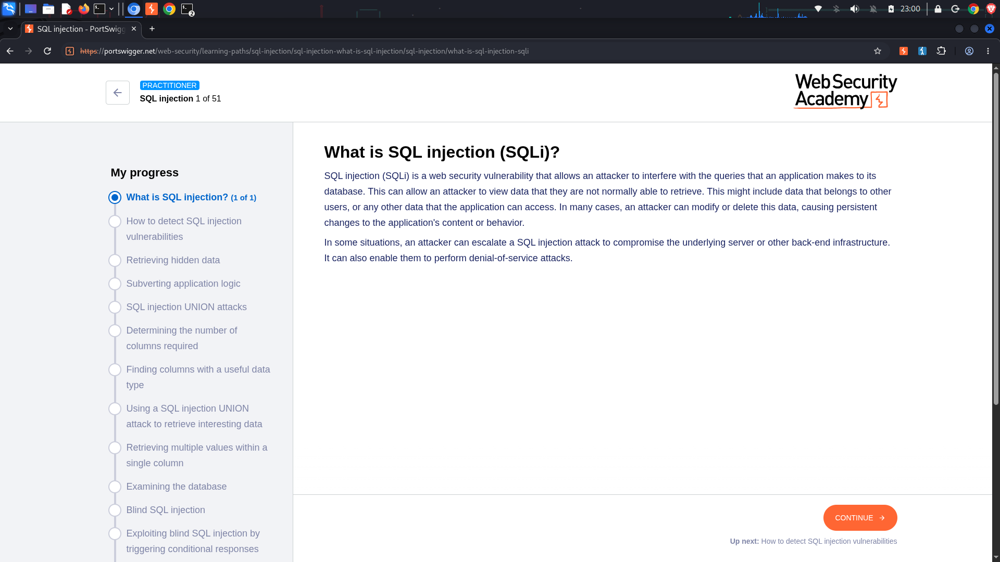
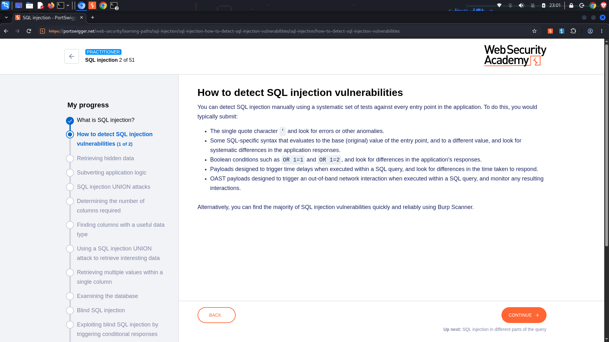
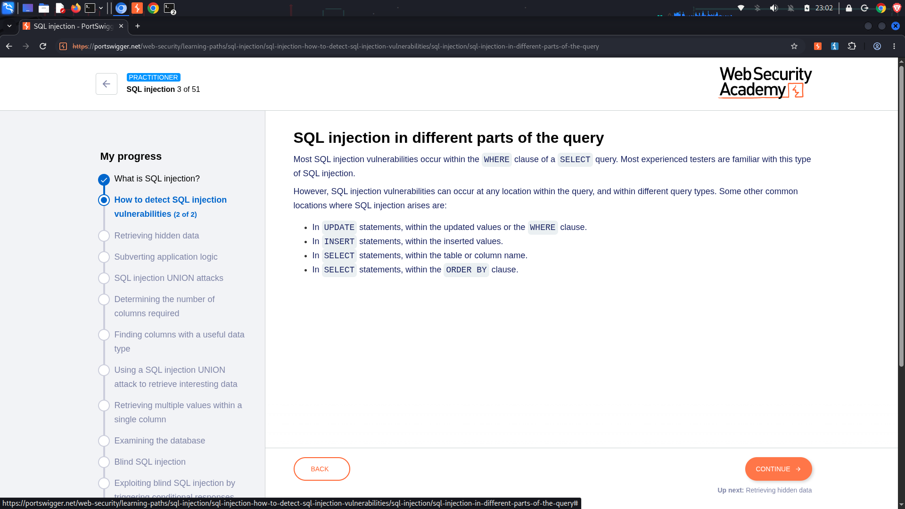

#  SQL Injection (SQLi)
> **Technical breakdown of input concatenation flaws, database query subversion, and structural extraction vectors.**

This section documents core methodologies for detecting and exploiting SQL Injection vulnerabilities. The primary focus centers on manipulating dynamic backend data queries to bypass authentication, expose hidden administrative records, and exfiltrate database contents.

---

##  Core Vulnerability Mechanics

SQL Injection (SQLi) occurs when an application takes user-controlled input and blindly concatenates it directly into a dynamic backend database query string instead of processing it safely as a separated parameter. 

This architectural flaw allows an attacker to manipulate the underlying query structure, forcing the database engine to execute arbitrary SQL commands. Depending on the environment, an attacker can leverage this exposure to view unauthorized records, modify data fields, or escalate privileges to compromise the host operating system.

###  Common Query Injection Points
While most entry points exist within the `WHERE` clause of a standard `SELECT` statement, vulnerable contexts frequently span across multiple application database workflows:
*   **`SELECT` Statements:** Manipulating parameter inputs inside table cells or column names.
*   **`UPDATE` Statements:** Injecting strings inside updated values or corresponding query filtering conditions.
*   **`INSERT` Statements:** Subverting values mapped for fresh database row additions.
*   **`ORDER BY` Clauses:** Appending payloads inside sorting modifiers to manipulate table ordering rules.

---

##  Vulnerability Detection Methodology

Identifying SQL Injection relies on a systematic checklist of diagnostic checks applied directly to application parameter entry points:

### 1. Syntax Breakage Testing
*   Inject a single quote character (`'`) or double quote (`"`) directly into the target input parameter field.
*   **What to look for:** Analyze the HTTP response for anomalous changes, such as a drop in content length, a server-side syntax error message, or a standard HTTP `500 Internal Server Error`.

### 2. Boolean Logic Evaluation
*   Supply specific SQL-specific boolean expressions that evaluate to a definitive true or false state (e.g., `' OR 1=1--` vs `' OR 1=2--`).
*   **What to look for:** Check if the application returns different output views based on the logical truth of the injected condition.

### 3. Time Delay Testing
*   Inject specialized database-specific function calls designed to force a hard execution delay (e.g., `pg_sleep(5)` or `WAITFOR DELAY '0:0:5'`).
*   **What to look for:** Monitor network response metrics to see if the server takes significantly longer to transmit response packets.

### 4. Out-of-Band (OAST) Interactions
*   Trigger an out-of-band network request back to an analyst-controlled listener utilizing database-specific network hooks.

---

##  Laboratory Analysis Blueprint

All specific laboratory challenges cleared within this track are documented utilizing a consistent four-phase penetration testing ledger layout:

```text
├──  Objective        -> Defining extraction targets, flag conditions, and query context
├──  Analysis         -> Mapping parameters, input fields, and database behavior
├──  Traffic Logs     -> Code blocks containing raw HTTP requests and compiled SQL strings
├──  Exploitation    -> Step-by-step walkthrough detailing weaponized bypass payloads
└──  Remediation     -> Exact secure coding practices required to secure the query logic
```

---

##  Foundational Concepts Reference

The following architectural milestones map the theoretical progression through this core exploitation module:

### 1. Defining the SQLi Threat Matrix


### 2. Manual Detection Rules Checklist


### 3. Query Structural Component Inspection


---

##  Defensible Engineering Remediation
To systematically eliminate SQL Injection risks, development teams must entirely abandon dynamic input string construction routines:
*   **Mandate Parameterized Queries (Prepared Statements):** Ensure the database engine compiles the query template structure first, treating user-supplied variables strictly as data inputs rather than executable syntax.
*   **Enforce Strict Allowlisting for Structural Components:** If inputs must modify structural items like column names or sorting rules (where prepared statements cannot be natively applied), cross-reference user data against a hardcoded array of trusted parameters before transmission.
