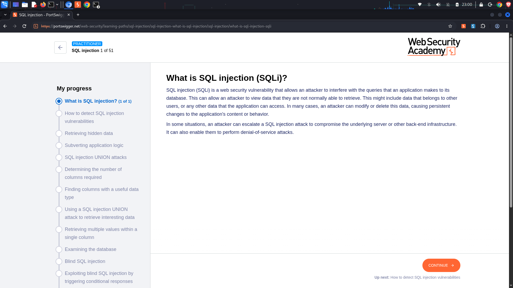
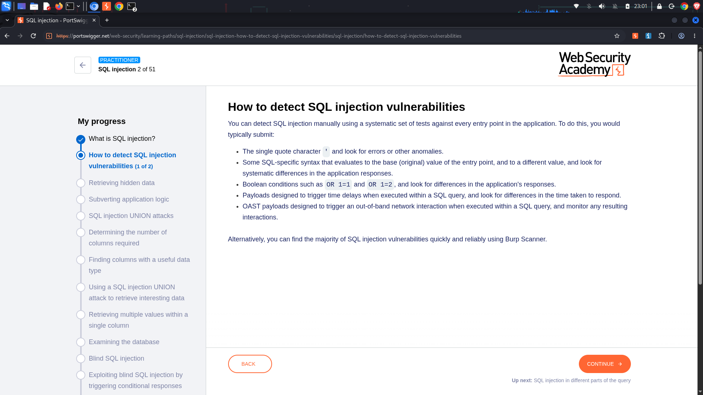
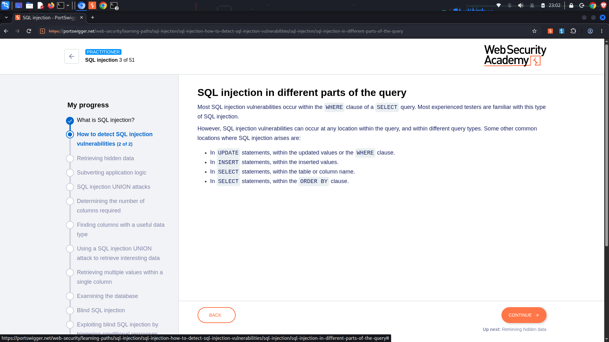
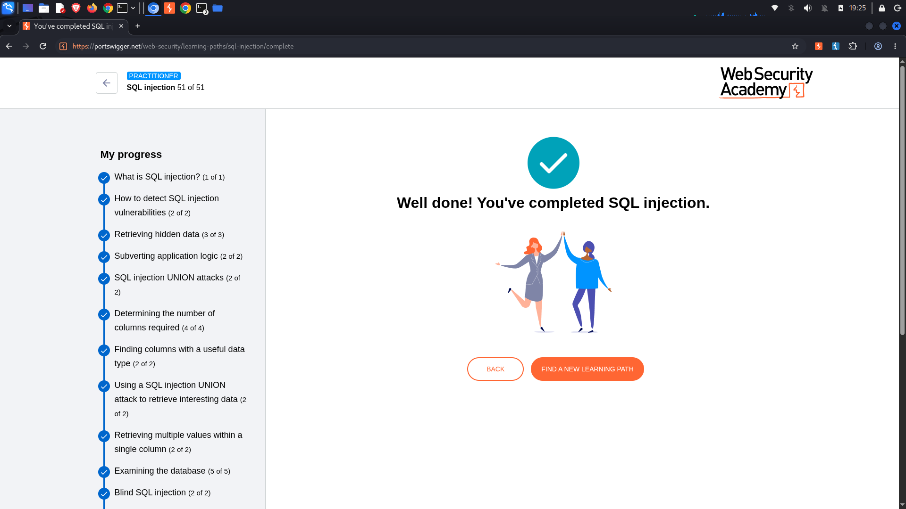

#  SQL Injection (SQLi)
> **Technical breakdown of input concatenation flaws, database query subversion, and structural extraction vectors.**

This section documents core methodologies for detecting and exploiting SQL Injection vulnerabilities. The primary focus centers on manipulating dynamic backend data queries to bypass authentication, expose hidden administrative records, and exfiltrate database contents.

---

##  Core Vulnerability Mechanics

SQL Injection (SQLi) occurs when an application takes user-controlled input and blindly concatenates it directly into a dynamic backend database query string instead of processing it safely as a separated parameter. 

This architectural flaw allows an attacker to manipulate the underlying query structure, forcing the database engine to execute arbitrary SQL commands. Depending on the environment, an attacker can leverage this exposure to view unauthorized records, modify data fields, or escalate privileges to compromise the host operating system.

###  Common Query Injection Points
While most entry points exist within the `WHERE` clause of a standard `SELECT` statement, vulnerable contexts frequently span across multiple application database workflows:
*   **`SELECT` Statements:** Manipulating parameter inputs inside table cells or column names.
*   **`UPDATE` Statements:** Injecting strings inside updated values or corresponding query filtering conditions.
*   **`INSERT` Statements:** Subverting values mapped for fresh database row additions.
*   **`ORDER BY` Clauses:** Appending payloads inside sorting modifiers to manipulate table ordering rules.

---

##  Vulnerability Detection Methodology

Identifying SQL Injection relies on a systematic checklist of diagnostic checks applied directly to application parameter entry points:

### 1. Syntax Breakage Testing
*   Inject a single quote character (`'`) or double quote (`"`) directly into the target input parameter field.
*   **What to look for:** Analyze the HTTP response for anomalous changes, such as a drop in content length, a server-side syntax error message, or a standard HTTP `500 Internal Server Error`.

### 2. Boolean Logic Evaluation
*   Supply specific SQL-specific boolean expressions that evaluate to a definitive true or false state (e.g., `' OR 1=1--` vs `' OR 1=2--`).
*   **What to look for:** Check if the application returns different output views based on the logical truth of the injected condition.

### 3. Time Delay Testing
*   Inject specialized database-specific function calls designed to force a hard execution delay (e.g., `pg_sleep(5)` or `WAITFOR DELAY '0:0:5'`).
*   **What to look for:** Monitor network response metrics to see if the server takes significantly longer to transmit response packets.

### 4. Out-of-Band (OAST) Interactions
*   Trigger an out-of-band network request back to an analyst-controlled listener utilizing database-specific network hooks.

---

##  Laboratory Analysis Blueprint

All specific laboratory challenges cleared within this track are documented utilizing a consistent four-phase penetration testing ledger layout:

```text
├──  Objective        -> Defining extraction targets, flag conditions, and query context
├──  Analysis         -> Mapping parameters, input fields, and database behavior
├──  Traffic Logs     -> Code blocks containing raw HTTP requests and compiled SQL strings
├──  Exploitation    -> Step-by-step walkthrough detailing weaponized bypass payloads
└──  Remediation     -> Exact secure coding practices required to secure the query logic
```

---

##  Foundational Concepts Reference

The following architectural milestones map the theoretical progression through this core exploitation module:

### 1. Defining the SQLi Threat Matrix


### 2. Manual Detection Rules Checklist


### 3. Query Structural Component Inspection


---

##  Defensible Engineering Remediation
To systematically eliminate SQL Injection risks, development teams must entirely abandon dynamic input string construction routines:
*   **Mandate Parameterized Queries (Prepared Statements):** Ensure the database engine compiles the query template structure first, treating user-supplied variables strictly as data inputs rather than executable syntax.
*   **Enforce Strict Allowlisting for Structural Components:** If inputs must modify structural items like column names or sorting rules (where prepared statements cannot be natively applied), cross-reference user data against a hardcoded array of trusted parameters before transmission.

# Learning Path Recap: Web Security Academy - SQL Injection

## 1. Executive Summary
This document provides a final comprehensive recap of the completed **SQL Injection (SQLi)** training module. The path progressed from fundamental vulnerabilities (retrieving hidden data, subverting application logic) to complex data exfiltration methodologies (UNION-based queries, database fingerprinting, blind exploitation using conditional responses/time delays). The module concluded with advanced filter evasion strategies via alternative injection contexts (XML Hex entity encoding) and structural remediation planning. 

---

## 2. Comprehensive Knowledge Mapping

### Vulnerability Types Mastered
*   **In-Band SQLi (UNION-Based):** Determining query column structures and field data types to join arbitrary database records alongside legitimate application payloads.
*   **Blind SQLi (Conditional Responses):** Exfiltrating database contents bit-by-bit by monitoring true/false application behaviors and response changes.
*   **Blind SQLi (Time Delays):** Inducing database-side execution pauses (e.g., `pg_sleep()`) to exfiltrate parameters when standard outputs or status codes are completely static.
*   **Second-Order SQLi (Stored Injection):** Introducing payloads that sit securely inside a database table upon initial receipt (safe storage), but break logic layers later when the application retrieves and processes that data into a separate query template.

### Contextual Defenses Broken
*   **Obfuscated Vector Contexts:** Overcoming perimeter monitoring (WAFs) by transitioning from standard URL/Form inputs to embedded structured data structures (JSON and XML payloads).
*   **WAF Rule Evasion:** Constructing specific encoder chains (such as `<@hex_entities>`) to ensure payloads appear benign during parameter inspection but decode cleanly back into raw code right before reaching the relational database management system (RDBMS).

---

## 3. Core Remediation Matrix

To definitively mitigate SQL Injection across all discovered variants, developers must enforce the following strategies outlined at the conclusion of the track:

| Remediation Tier | Technical Implementation Strategy | Prevention Objective |
| :--- | :--- | :--- |
| **Primary Core Fix** | **Parameterized Queries (Prepared Statements)** | Ensures that all user-supplied data inputs are bound explicitly as safe variables, preventing the RDBMS from interpreting input fields as executable code syntax. |
| **Input Validation** | **Strict Strict Allowlisting** | Rejects or ignores non-conforming character arrays prior to logical layer operations, preventing unexpected SQL commands or special characters entirely. |
| **Behavioral Logic** | **Separation of Parameters** | Redesigns application processes so structural variables (like table or column names) cannot be influenced or passed via client-side requests. |

---

## 4. Final Verification Summary
The completion of all 51 baseline and practitioner assessment objectives marks a thorough operational understanding of SQL injection attack lifecycles and modern remediation concepts.



